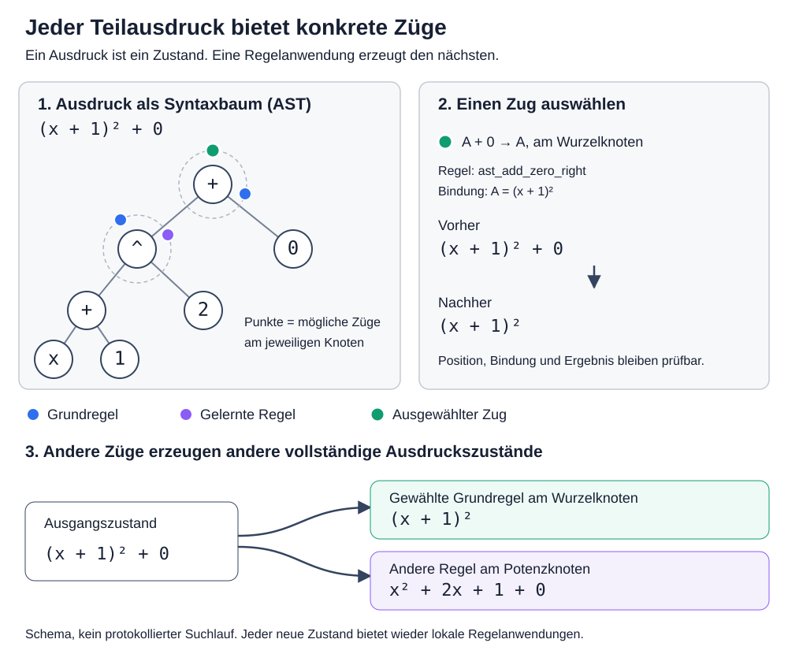
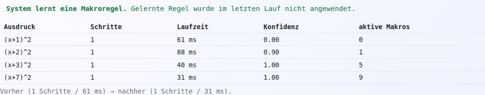
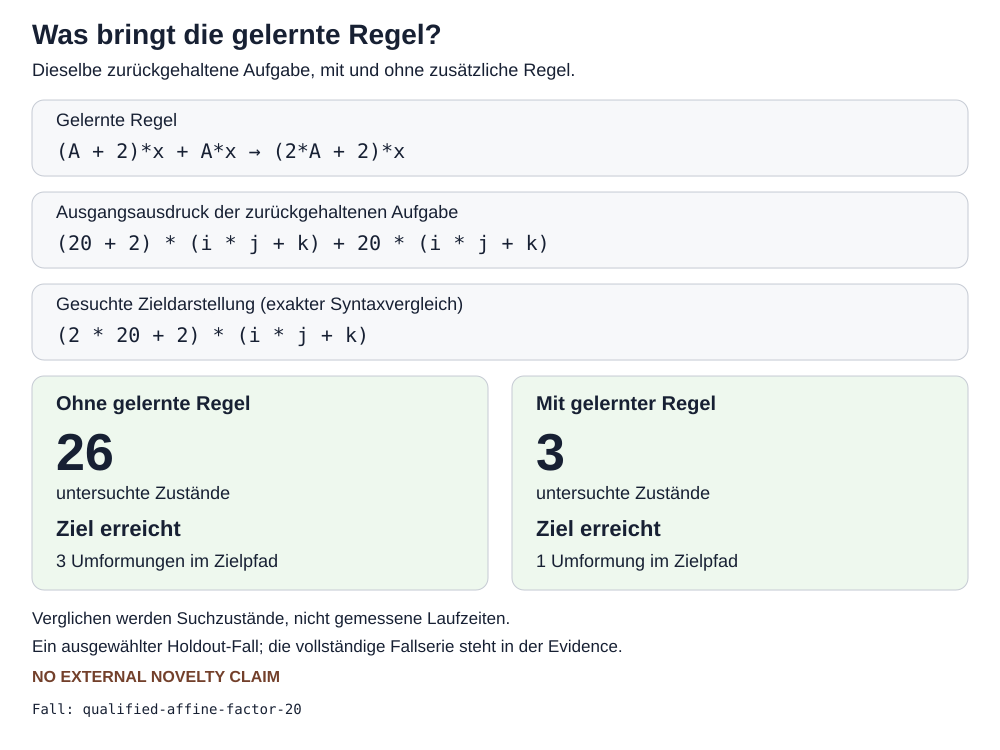
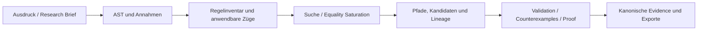

# Regelsuche

[](https://github.com/carstenartur/Regelsuche/actions/workflows/gradle.yml)
[](https://carstenartur.github.io/Regelsuche/coverage/)
[](https://carstenartur.github.io/Regelsuche/tests/)
[](https://carstenartur.github.io/Regelsuche/dev/bench/)
[](https://github.com/carstenartur/Regelsuche/dependency-graph/sbom)
[](LICENSE)
[](https://doi.org/10.5281/zenodo.20951900)

**Mathematik als durchsuchbares Spiel:** Regelsuche erforscht Verfahren zur
symbolischen Suche, zur Wiederverwendung geprüften Wissens und zur Herleitung
effizienterer Rechenpläne. Die Workbench macht mögliche Regelanwendungen,
untersuchte Alternativen und den Weg zum Ergebnis sichtbar. Native mathematische
Verfahren und eigenständig nutzbare Java-SDKs verbinden diese Suche mit
strukturellen Aufgaben, kumulativem Lernen und geprüften Rechenoptimierungen.

[Demo starten](#schnellstart) ·
[Ersten Rechenweg untersuchen](#erster-ablauf-einen-rechenweg-verstehen) ·
[Forschungsverfahren und Ergebnisse](#lernen-muss-sich-auf-unbekannten-fällen-auszahlen) ·
[Rechenpläne herleiten](#geprüfte-rechenpläne-herleiten) ·
[Erweitern und integrieren](#in-wenigen-zeilen-erweitern)

**English:** [Start here](docs/start-here.md) · [recorded browser demo](docs/demos/recorded-discovery.html)
(no installation) · [released Java SDK 0.5.2](docs/java-sdk-quickstart.md).

## Für wen und wofür?

| Zielgruppe | Unterstützter Einstieg | Ergebnis |
| --- | --- | --- |
| Lernende und Lehrende | Ausdruck eingeben, Herleitungen vergleichen, einen Weg im Replay prüfen | nachvollziehbare Zwischenschritte mit Annahmen; Markdown- oder LaTeX-Export |
| Forschende zu symbolischer Suche und Regelwiederverwendung | Suchverfahren und gelernte Strategien auf getrennten Aufgaben unter vergleichbaren Budgets untersuchen | prüfbare Suchpfade, Arbeitsbilanzen und auch negative Ergebnisse |
| Java-Entwicklerinnen und -Entwickler | Regeln, Suchprogramme oder eigene Discovery-Domänen über das SDK einbinden | headless ausführbare Erweiterungen mit expliziten Budgets und Evidence |
| Entwickelnde von Quellcodeanalysen und Refactorings | typisierte Rechenmodelle an das Optimierungs-SDK übergeben | mathematisch geprüfte Kandidaten und Rechenpläne für einen Quelladapter |

Die zentrale Forschungsfrage lautet: **Wann spart die Wiederverwendung gelernter
Regeln auf neuen Aufgaben insgesamt Arbeit, wenn Erwerb, Auswahl, Laden und
Verifikation mitgezählt werden?** Weitere Fragen betreffen die Wahl geeigneter
Darstellungen, die Übertragung gelernter Strukturen und die Ableitung günstigerer
Algorithmen. Die [Forschungsmethodik](docs/research-methodology.md) beschreibt,
wie Aufgaben, Kontrollen, Referenzverfahren und Kostenmodelle diese Fragen
prüfbar machen.

## Schnellstart

Die **Standarddemo läuft ohne externe Infrastruktur**. Sie benötigt weder eine
Datenbank noch einen externen Solver. Im Repository-Verzeichnis mit Docker:

```bash
docker build -t regelsuche .
docker run --rm -p 127.0.0.1:8080:8080 regelsuche
```

Danach `http://127.0.0.1:8080/` öffnen. Die Bindung an `127.0.0.1` hält die
Demo lokal; sie verwendet HTTP ohne Anmeldung.

Ohne Docker genügt für den vorhandenen Entwicklungslauncher JDK 25:

```bash
./gradlew run
```

Der Java-Produktbuild besitzt inzwischen einen vollständigen Maven-Reaktor:
`mvn --batch-mode --no-transfer-progress test` führt die normalen JUnit-Tests
mit JDK 25 und Maven 3.9.9+ aus; `mvn package` erzeugt die Distributionen unter
`app/target/`. Die bestehenden Gradle-/Reproduktions-Gates bleiben während der
Migration zusätzlich erforderlich. [Build- und Modulstand](docs/module-structure.md)
und [Testing](docs/testing.md) unterscheiden diese Prüfumfänge.

Der vollständige Einstieg einschließlich Sicherheitshinweisen und
Fehlerdiagnose steht in [Getting Started](docs/getting-started.md).

## Erster Ablauf: einen Rechenweg verstehen

Ein Einstieg für Lernen und Lehren ist die binomische Formel:

1. Im Tab **Workbench** `(x+3)^2` in **Ausdruck** eingeben, als **Ziel**
   **Schulweg** wählen und **Suche starten**. Alternativ die vorbereitete Demo
   **Binomische Formel** starten.
2. Unter **Pfade** die gefundenen Herleitungen vergleichen. **Schulbuch** oder
   **Schritte** zeigt die Umformungen in einer lesbaren Darstellung.
3. Einen Pfad öffnen und unter **Replay** schrittweise abspielen. Dabei die
   hervorgehobenen Änderungen, Regelhinweise und Annahmen prüfen.
4. Unter **Exporte** Markdown für Arbeitsmaterialien oder LaTeX für
   mathematische Texte herunterladen.

Die Demo führt zu `x^2 + 6*x + 9`; der Rechenweg zeigt, wie dieses Ergebnis
entsteht. Weiterführende Tabs erscheinen nach dem ersten Suchlauf oder dem
Start einer Demo. Weitere Abläufe, etwa zum Vergleichen von Ergebnisformen und
zum Prüfen von Regelkandidaten, stehen in [User Workflows](docs/user-workflows.md).
Ein Replay ist eine nachvollziehbare Ableitung, aber nicht automatisch ein
formaler Beweis; dafür gelten die getrennten [Proof-Workflows](docs/proof-workbench.md).

## Was Regelsuche sichtbar macht

| Statt einer Black Box | Regelsuche zeigt |
| --- | --- |
| nur das Endergebnis | alternative Rechenwege und den erkundeten Suchraum |
| einen undurchsichtigen Simplifier-Aufruf | die konkrete Regel an der konkreten AST-Position |
| ungebundene Heuristik | Kosten, Budgets, Pruninggründe und Annahmen |
| eine neu gelernte Abkürzung ohne Herkunft | den expandierbaren primitiven Pfad und seine Lineage |
| einen Solverstatus ohne Artefakte | Obligation, Backend-Ausgabe, Hashes und reproduzierbare Evidence |

Best-First, Beam, `A*`, Monte Carlo und Equality Saturation können auf denselben
expliziten Zuständen und Kanten arbeiten. Die grafische Workbench verbindet
Suchgraph, Pfade, Replay, AST-Regelradar, Kandidaten, Proof-Jobs und Exporte in
einem Ablauf.



*Schematische Erklärung, kein Suchprotokoll: Ein Ausdruck ist eine Spielposition.
Die Punkte an den AST-Knoten stehen für konkrete Regelanwendungen. Der gewählte
Zug entfernt die Addition von null; eine andere Regel am Potenzknoten erzeugt
einen anderen vollständigen Ausdruck. Position, Bindungen und Ergebnis bleiben
nachvollziehbar.*

## Workbench statt Konsolenausgabe

Browser-E2E-Tests prüfen die sichtbaren Abläufe und erzeugen dieselben
Dokumentationsaufnahmen. Der folgende kompakte Ausschnitt zeigt einen Lauf, in
dem ein mehrstufiger Pfad als Makro gelernt und erneut verwendet wird.



Weitere Aufnahmen in voller Größe: [rationale Umformung mit Ergebnis und Suchdaten](docs/assets/screenshots/rational-summary.png)
und [Vorschau einer Matrixdarstellung](docs/assets/screenshots/math-matrix-preview.png).

Weitere sichtbare Abläufe: [Pfade, Graph und Replay](docs/web-ui-user-guide.md),
[AST-Regelradar](docs/ast-rule-radar.md),
[Proof Workbench](docs/proof-workbench.md) und
[User Workflows](docs/user-workflows.md).

## Lernen muss sich auf unbekannten Fällen auszahlen

Regelsuche kann geprüftes Aufgabenwissen über mehrere Generationen aufbauen,
speichern und nach erneuter Prüfung weiterverwenden. Spätere Lernschritte nutzen
dabei tatsächlich das vorherige Wissen. Zwei ausgeführte Entwicklungsversuche
zeigen einen geringeren Gesamtaufwand im jeweils deklarierten logischen
Kostenmodell:

| Versuch | Vergleichsbasis | Kumulatives Wissen einschließlich Erwerb und erneuter Vorbereitung |
| --- | ---: | ---: |
| [512 Aufgaben, drei Wissensgenerationen](docs/research/cumulative-task-knowledge.md#executed-development-observations) | 225.536 Einheiten | 186.706 Einheiten, **17,2 % weniger** |
| [32 Strukturaufgaben, zwei gelernte Fähigkeiten](docs/research/structural-construction-learning.md#executed-development-results) | 506.872 Einheiten | 163.881 Einheiten, **67,7 % weniger** |

Die jeweiligen Vergleichsarme erreichen dieselben Aufgabenerfolge; auch einfache
und erfolglose Fälle bleiben in der Bilanz. Die Ströme verwenden bekannte
Entwicklungsfamilien. Logische Arbeit, Laufzeit und CPU werden getrennt bewertet.
[Vorbereitete Wissenssitzungen und kostenbewusste Selbstverbesserung](docs/prepared-task-knowledge.md)
erweitern den Lebenszyklus um begrenzte Wiederverwendung bereits geprüfter
Generationen und gemessene Übernahmeentscheidungen. Im zugehörigen
[Laufzeitversuch](docs/research/knowledge-lifecycle-improvement-2026-11-07.md)
amortisiert sich der zusätzliche Lernversuch gegenüber der bestehenden
persistenten Sitzung noch nicht.

### Strukturelle Aufgaben und historische Beispiele

Der gemeinsame Aufgabensolver kann eine nichttriviale Faktorisierung oder eine
Darstellung als Summe zweier Quadrate suchen. Für vorgegebene affine
Rekurrenzübergänge werden begrenzte Polynomansätze gebildet; eine unabhängige
Prüfung von Übergangsidentität und Anfangswert sichert die gefundenen Invarianten.
Der [historische Methodenvergleich](docs/research/historical-sympy-comparison-2026-11-06.md)
enthält folgende ausgeführte Ergebnisse:

| Aufgaben | Native Basis | Mit gelerntem Wissen | Referenzverfahren |
| --- | ---: | ---: | ---: |
| Cassini, Pell, Brahmagupta–Fibonacci und Sophie Germain | 4/4 | 4/4 | 4/4 |
| Zehn öffentliche Varianten | 6/10 | 10/10 | 10/10 |

Die vier zusätzlichen Erfolge verwenden gelernte Regeln. Aufgabenfamilien,
Lehr-/Validierungsüberschneidungen, negative Kontrollen und vollständige
Lebenszykluskosten sind im Bericht ausgewiesen. Die Verfahren erhalten Quelle
und Aufgabenziel beziehungsweise Rekurrenz und Anfangszustand; die mathematischen
Ansatzräume werden von der Implementierung bereitgestellt.

### Referenzmessungen für einzelne Verfahrensaspekte

In diesen Vergleichsprofilen dient SymPy als ohne Lizenzgebühren nutzbare
Referenzimplementierung. Andere geeignete Software kann dieselbe methodische
Rolle übernehmen. Untersucht werden die festgelegten Verfahren, Aufgaben und
Messgrößen; die [Forschungsmethodik](docs/research-methodology.md) erläutert die
Auswahl und die Informationsgrenzen.

Das optionale [native Polynomprofil](docs/native-polynomial-simplification.md)
ergänzt exakte Bruchrechnung, Normalisierung, Ausklammern und Faktorisierung im
gemeinsamen Suchkern. Im [Vergleich vom 6. November 2026](docs/research/native-polynomial-parity-2026-11-06.md)
benötigen beide nativen Varianten bei 69 der 72 unterstützten Fall-IDs gleich
viele arithmetische Syntaxoperationen wie das feste Referenzportfolio und bei
drei weniger. Die Fall-IDs enthalten 70 unterschiedliche Eingaben. Die native
Basis benötigt rund 9,2 Sekunden, das Referenzportfolio rund 2,1 Sekunden pro
vollständiger Aufgabenfolge. Das gelernte Profil erzielt hier keine zusätzliche
Qualitäts- oder Gesamtkostenverbesserung gegenüber der nativen Basis.

### Einen gelernten Pfad untersuchen

Der qualifizierte autonome Walkthrough bildet aus targetfreien Beobachtungen
einen parametrisierten Kandidaten, trennt Kandidatenbildung und Prüfung und
misst anschließend die Wiederverwendung auf zurückgehaltenen Aufgaben. Im hier
gezeigten öffentlichen Entwicklungsfall erreichen inzwischen beide Varianten
die verlangte Zieldarstellung:

| Variante | Ziel erreicht | Untersuchte Zustände | Umformungen |
| --- | --- | ---: | ---: |
| Verbesserte Basis | ja | 26 | 3 |
| Mit gelernter Regel | ja | 3 | 1 |



*Hier wird die gelernte Regel mit `A = 20` und `x = i*j + k` wiederverwendet.
Gesucht ist eine bestimmte syntaktische Zieldarstellung, nicht irgendein
äquivalenter Ausdruck. Die Zahlen vergleichen untersuchte Zustände, keine
Laufzeiten. Erwerb, Auswahl, Laden und Nachweisprüfung sind damit noch nicht
wirtschaftlich bilanziert. Der bekannte Entwicklungsfall zeigt Instanztransfer;
ein unberührter Finaltest und eine vollständige Laufzeitbilanz gehören zu
getrennten Versuchsprotokollen.*

Die vollständige Fallserie, Kandidaten-Lineage, Hashbindung und unabhängige
Prüfung stehen im [Autonomous Discovery Walkthrough](docs/autonomous-discovery-walkthrough.md).
Das ist projektinterne, symbolisch geprüfte Wiederverwendung — **keine
Behauptung externer mathematischer Neuheit**.

Frühere, separat eingefrorene Lernversuche behalten ihre eigenen Ergebnisse.
Die verlinkten Berichte enthalten Versuchsaufbau, Herkunft, Vergleichszeilen
und Reproduktionswege:

| Lernpfad | Beobachtung und Grenze |
| --- | --- |
| [Vorlagen aus verifizierten Polynomspuren](docs/trace-derived-polynomial-plans.md) mit [Auswahl auf getrennten Trainingsaufgaben](docs/finite-polynomial-strategy-selection.md) | Jede Anwendung löst ihre Koeffizienten neu und prüft ihre Schritte erneut. Herkunft, Anwendbarkeit und Trainingsausschlüsse bleiben erhalten. Beispiele derselben quadratischen Familie belegen noch keinen Transfer auf andere Familien oder allgemeinen Effizienzgewinn. |
| [Verzweigende Regelfolgen](docs/trace-strategy-transfer.md) aus zielausdrucksfreien Suchwegen | Der Vergleich auf neuen Zusammensetzungen mit denselben Einzelregeln und veränderter Regelreihenfolge liefert gleiche Ergebnisse bei **mehr Sucharbeit** mit dem gelernten Programm. Die HTML-Demo zeigt jeden primitiven Schritt und alle Vergleichszeilen. |
| [Gezielte Fortsetzung gelernter Strategien](docs/conditional-strategy-dispatch.md) | Auf getrenntem TRAIN wird gelernt, wann einmal kompilierte Fortsetzungen bereits erzeugter erster Schritte nützlich sind. Auf 288 neuen Entwicklungsaufgaben fallen bei gleicher Ergebnisqualität **1,4 % weniger gezählte Anwendungsarbeit als bei der starken Greedy-Kontrolle** an. Die einmaligen Lernkosten sind noch nicht eingespielt; irreführende Hinweise und teurere Einzelfälle bleiben sichtbar. |

Die [Regelbildung prüft kürzere primitive Wege](docs/primitive-trace-minimality.md),
bevor sie eine Umformungsfolge übernimmt. Ein beobachteter 20-Schritt-Umweg darf
dadurch keinen Wert von 20 erhalten, wenn zwei Schritte genügen. Ungeklärte
Minimalität führt zur Ablehnung; Nachweise und Prüfkosten werden gespeichert.

## Darstellungen wählen, übertragen und unabhängig prüfen

Für rationale lineare Systeme kann Regelsuche unabhängige Gleichungsblöcke
bereits aus der Quelle erkennen und getrennt lösen. Ein begrenzter Lerner
gewinnt die Auswahlbedingung aus überprüften Trainingsläufen. Die
[Browserdemo](docs/representation-transfer-demo.md) zeigt beide Wege, den
eingefrorenen Transfervergleich und exportierbare Nachweise.

Im aktuellen öffentlichen Entwicklungssatz spart die feste automatische
Darstellungswahl rund 6 % gezählte Arbeit einschließlich zusätzlicher
Prüfverfahren. Das Lernen bringt gegenüber dieser festen Auswahl noch
keinen zusätzlichen Kostenvorteil. Alle Trainingskosten und negativen
Kontrollen stehen im [vollständigen Vergleich](docs/representation-strategy-transfer.md).
Die [Ursachenanalyse](docs/representation-learning-diagnosis.md) zeigt: Die feste
Regel wählt bereits durchgehend den günstigsten gemessenen Weg. Gelernt wird
hier eine Auswahlbedingung; mathematische Verfahren sind schon vorgegeben.
Der installierbare [Python-Client](docs/python-client.md) prüft die vollständigen
rationalen Lösungsmengen unabhängig vom Java-Server.

## Beispiel: eine versteckte Faktorisierung als Suchraum

Ausgangspunkt und Ziel des generierten Sophie-Germain-Szenarios sind:

```text
x^4 + 4*y^4

→ (x^2 - 2*x*y + 2*y^2) * (x^2 + 2*x*y + 2*y^2)
```

Interessant ist nicht, dass die bekannte Identität irgendwo hinterlegt werden
könnte. Der Lauf behält vielmehr die tatsächlich untersuchten Zustände, die
vorbereitende Bridge, die primitive Faktorisierung, das daraus gebildete Makro
und dessen spätere Wiederverwendung. Der detaillierte Suchgraph wird aus der
kanonischen Evidence erzeugt, nicht für das README nachgezeichnet.

[Suchgraph zur Detailinspektion in voller Größe](docs/generated/discovery/sophie-germain/search-space.svg) ·
[Evidence dieses Laufs](docs/generated/discovery/sophie-germain/evidence.json) ·
[visuelle Discovery Gallery](docs/demo-gallery.md) ·
[domänenbewusste Polynomfaktorisierung](docs/domain-aware-polynomial-factorization.md)

## Einen Ein-Pass-Algorithmus aus einer Paarsumme herleiten

Öffne in der Workbench **Paarberechnungen beschleunigen** und gib den Summanden
für ein Paar von Zeilen ein. Aus `(x_i-x_j)^2` leitet Regelsuche die beiden
Zwischensummen für `x` und `x*x` her. Für 100.000 Zeilen stellt die Demo
4.999.950.000 Paarberechnungen einem Durchlauf mit 100.000 Zeilen gegenüber.
Du kannst die Herleitung, die symbolische Prüfung und die benötigten
Zwischensummen ansehen. Die gewichtete Variante und Paarprodukte mit
Diagonalkorrektur lassen sich mit demselben Verfahren herleiten.
[SDK und Nachweis](regelsuche-optimization-sdk/FINITE_SERIES.md#one-pass-pair-reductions)

## Geprüfte Rechenpläne herleiten

Die Paarsumme ist ein sichtbarer Einstieg in einen größeren Optimierungsbereich.
Der mathematische Kern und das [Optimierungs-SDK](regelsuche-optimization-sdk/README.md)
bieten zusätzlich folgende begrenzte Modelle und unabhängige Prüfungen:

| Rechenmodell | Abgeleiteter Plan |
| --- | --- |
| Polynomsummen mit einer zur Laufzeit bekannten Anzahl | Newton-/Binomialdarstellung; exakte verschachtelte, periodische und stückweise Komposition |
| Rationale Summen im unterstützten Fragment | Teleskopieren mit Prüfung der Polstellen im gesamten Iterationsbereich |
| Affine und gekoppelte lineare Zustände | geprüfte Übergangsmatrix und binäres Potenzieren, etwa für geometrische Summen und Rekurrenzen |
| Rollende Paarsummen | inkrementelle Einfüge-/Entfernungsschritte auch für asymmetrische Polynome |
| Geordnete und gefilterte Tupel | skalare, Hash- oder Bereichszusammenfassungen entsprechend den Schlüsselbedingungen |
| Geeignete Potenzen und Inverse | Gruppierung, Herausziehen unveränderlicher Teile und Batch-Inversionspläne |

[Summen und Iterationen](regelsuche-optimization-sdk/FINITE_SERIES.md) beschreibt
Definitionsbereiche, Budgets und Grenzen. Für
[Batch-Inversion](regelsuche-optimization-sdk/FINITE_SERIES.md#batch-inversion-plans)
prüft der Kern auch die Zuordnung jedes einzelnen Ergebnisses. Die
[Standalone-CLI für gezählte Summen](regelsuche-optimization-sdk/README.md#standalone-counted-sum-cli)
macht einen Teil dieser Verfahren über einen begrenzten JSON-Vertrag zugänglich.

Feste Iterationen, Paar- und geordnete Reduktionen sowie Inversionspläne verwenden
den gemeinsamen Suchpfad. Laufzeitgebundene Reihen und lineare Iterationen besitzen
zusätzliche SDK-Schnittstellen. Ein Quelladapter prüft die konkrete
Zahlensemantik, Seiteneffekte, Ausnahmebedingungen und die Übereinstimmung des
erzeugten Programms mit dem mathematisch geprüften Plan. Das
[Zusammenspiel mit Sandbox](#zusammenspiel-mit-sandbox) ordnet diese Aufgaben zu.

## Herleitungen mit Literatur verknüpfen

Regelrevisionen und einzelne Herleitungsschritte können zitierfähige Quellen
tragen. Das Replay zeigt freigegebene Bezüge; Markdown- und LaTeX-Exporte führen
die verwendeten Fundstellen auf. Herkunft einer Regel, ein verwendetes Lemma und
nachträglich gefundene Vorarbeit bleiben unterscheidbar.

Die private Literaturprüfung bindet ihre Bewertung an einen gespeicherten
Kandidaten. Der optionale Abruf über TheoremSearch ist standardmäßig ausgeschaltet;
bei aktivierter Funktion wird der konkrete Suchtext vor dem Absenden angezeigt.
Suchtreffer und die geprüfte Zuordnung einer Fundstelle haben getrennte Status.
[Literaturreferenzen und Vorarbeitsprüfung](docs/literature-references.md)

## Repräsentationsbrücken öffnen neue Mathematikbereiche

Regelsuche behandelt geeignete Gleichungssysteme nicht nur als Listen skalarer
Zeilen. Mit explizit deklarierten Rollen kann beispielsweise

```text
a*x + b*y = lambda*x
c*x + d*y = lambda*y
```

als Eigenproblem `A*v = lambda*v` erkannt, in die exakte Koeffizientenmatrix

```text
[[a-lambda, b],
 [c, d-lambda]]
```

überführt und bis `det(A - lambda*I) = 0` weitergeführt werden. Variablennamen
allein erzeugen keine physikalische Interpretation. Siehe
[Symbolische Gleichungssysteme und Eigenprobleme](docs/symbolic-eigenproblem-representation.md).

Die Workbench bietet außerdem **Alternative Darstellungen** mit aus der Quelle
gewonnenen Matrixprodukten, unabhängigen Blöcken und expliziten Operatorregeln.
Jede bestätigte Alternative behält die Variablenreihenfolge und einen exakten
Replay aller Quellzeilen. Nachweise lassen sich exportieren und nach einem
Neustart erneut prüfen. Siehe [Matrix- und Operatorvorbereitung](docs/matrix-operator-preparation.md)
für Profile, CLI, Grenzen und reproduzierbare Vergleichsnachweise.

## In wenigen Zeilen erweitern

### Eine mathematische Regeldatei

Regeln, Makros und Aktivierungsprofile können in einer kleinen DSL beschrieben
werden:

```text
rule difference_of_squares:
  pattern: A^2 - B^2
  replace: (A - B) * (A + B)
  direction: forward
  priority: 5
  tags:
    - factorization
  explanation: "Erkennt die Differenz zweier Quadrate."
```

Die Regel erscheint anschließend wie eine eingebaute Regel im Suchgraphen,
Replay und AST-Regelradar. Bedingungen, Profile, Import, Export und Debugging
beschreibt die Seite [Regeldateien](docs/rule-files.md).

### Eine Suchstrategie als typisiertes Java-Programm

Vorhandene Engines lassen sich ohne zweite Suchimplementierung kombinieren:

```java
import static de.regelsuche.search.program.RewritePrograms.*;
import de.regelsuche.search.program.RewriteProgram;

RewriteProgram strategy = firstApplicable(
    source(macroEngine),
    sequence(
        source(normalizationEngine),
        source(factorizationEngine)
    ),
    source(ordinaryRuleEngine)
).named("learn-or-derive");
```

Die Methoden und Engine-Objekte bestimmen das Verfahren. `named(...)` vergibt
nur die Wurzelkennung für Tracing und Evidence; die übrigen Knotenkennungen
entstehen deterministisch aus ihren Positionen. Es gibt keine Verfahrenssuche
über Zeichenfolgen. Bevorzugte Regeln werden ebenfalls als Objekte mit
`preferRules(normalizationRule, factorizationRule)` übergeben.

`Require`, `Prioritize` und `Prune` bleiben getrennte Operationen; Tracing kann
Kandidaten, verworfene Alternativen und reale Kürzungen sichtbar machen. Details
stehen unter [Java-internal Rewrite Programs](docs/java-rewrite-programs.md),
[typsichere Java-Integration](docs/type-safe-java-integration.md) und
[Plugin-API](docs/plugin-api.md).

### Installierte Discovery-Erweiterungen (Quellstand)

Die App kann authentifiziert installierte SPI-v2-Domänen mit einer bestehenden
Package-Konfiguration auflisten und ausführen:

```text
domains installed --config /absolute/package-config.json list
domains installed --config /absolute/package-config.json run provider-id domain-id@revision campaign-id seed.txt evidence.json [small|tiny]
```

Ein aktueller Authority-Snapshot bleibt bis zum kanonischen Evidence-Export
gebunden; Provider-, Contributor- und Installationsherkunft bleiben unterscheidbar.
Die Auswahl verwendet Provider-ID und exakte Domänenrevision. Der
[SDK-Leitfaden](docs/java-discovery-sdk.md#installierte-spi-v2-domänen-ausführen-aktueller-quellstand)
beschreibt Konfiguration, Budgets, Exitcodes und Java-Vertrauensgrenzen. Dies ist
keine rückwirkende Erweiterung veröffentlichter SDK-ZIPs. Workbench/HTTP, v1-Runtime
und Datenpakete bleiben eigenständige Migrationsschritte; signierter Code ist
weder sandboxed noch mathematisch autorisiert.

### Eigene Discovery-Domänen mit dem Java-SDK

[Java-Quickstart](docs/java-sdk-quickstart.md), [Domain-Tutorial](docs/java-sdk-domain-tutorial.md)
und [API-Vertrag](docs/java-sdk-api-policy.md) führen vom ersten Consumer zur eigenen
Domäne. Regel-Plugins verwenden das eigenständige `regelsuche-plugin-api`;
Provider-Evidence bindet die beobachteten Artefaktbytes.

Das headless nutzbare Java-25-SDK lässt eigene Zustände, Übergänge,
Gegenbeispielsuchen und Zertifikate in normalem Java definieren, ohne Webserver
oder Persistenz einzubinden. So sieht ein Lauf im
[eigenständig gebauten Folgenbeispiel](examples/external-consumers/geometric-sequence-domain-java25/README.md)
aus; der dort enthaltene Provider definiert die Domäne:

```java
import static de.regelsuche.sdk.discovery.DiscoveryRunAssertions.assertThat;
import de.regelsuche.sdk.discovery.DiscoveryBudgets;
import de.regelsuche.sdk.discovery.RegelsucheDiscovery;
import example.GeometricSequenceDomainProvider;
import example.GeometricSequenceDomainProvider.Input;
import java.util.List;

var input = new Input(List.of(2L, 4L, 8L, 16L), List.of(32L, 64L), 6);
var run = RegelsucheDiscovery
    .forDomain(GeometricSequenceDomainProvider.typedDomain())
    .campaign("external-geometric-sequence-demo")
    .seed("powers-of-two", input, "external-java25-example")
    .budget(DiscoveryBudgets.small())
    .run();

assertThat(run).isConfirmed().hasContentAddressedEvidence();
System.out.println(run.selectedCandidate().orElseThrow().multiplier()); // 2
```

Der Eingabetyp ist an die Domäne gebunden. Ein String-Payload oder ein Eingabeobjekt
einer anderen Domäne passt nicht auf diesen Java-Einstieg. Der domäneneigene Codec
übernimmt die bestehende Seed-Serialisierung; freie Kampagnen- und Herkunftsnamen
bleiben Texte. Details zu Importgrenzen und Migration stehen unter
[typsichere Java-Integration](docs/type-safe-java-integration.md).

Der Lauf sucht den Multiplikator aus den beobachteten Werten, behält
Gegenbeispiele und prüft den Kandidaten getrennt an den zurückgehaltenen Werten.
`CONFIRMED` gilt für diesen endlichen Prüfbereich, nicht als Beweis einer
allgemeinen Aussage über unendliche Folgen. Das vollständige Beispiel testet
auch `REFUTED`, `BUDGET_EXHAUSTED` und das Laden über `ServiceLoader`.

[Java Discovery SDK](docs/java-discovery-sdk.md) erklärt Builder, Budgets,
Assertions und Provider-SPI. Das **SDK 0.5.2 ist veröffentlicht**:
[GitHub Release vom 7. November 2026](https://github.com/carstenartur/Regelsuche/releases/tag/v0.5.2).
Der bevorzugte externe Weg verwendet das SDK-ZIP als Maven-Repository und das
[ausführbare Maven-Beispiel](examples/external-consumers/hello-rule-java25/).
Die API-Revisionen und Grenzen stehen im [API-Vertrag](docs/java-sdk-api-policy.md).
`main` ist `0.5.3-SNAPSHOT`; spätere API-Ergänzungen und dieses neue Consumer-POM
sind nicht rückwirkend Inhalt des 0.5.2-Archivs. Eine Veröffentlichung auf Maven
Central wird nicht behauptet.

### Zusammenspiel mit Sandbox

[Sandbox](https://github.com/carstenartur/sandbox) verbindet die mathematische
Suche mit Java-Quellcode. Regelsuche verantwortet die Suche nach Kandidaten und
deren unabhängige mathematische Prüfung im unterstützten numerischen Bereich.
Der Sandbox-Adapter verantwortet Java-AST und Extraktion, die Behandlung von
Effekten und Quellkontext sowie Quelltextänderungen mit Vorschau, Anwenden und
Rücknahme. Vor dem Anwenden muss er die Aktualität von Quelle und Umgebung prüfen.

Die Schnittstelle und ihre Grenzen stehen im
[Integrationsvertrag für Quelladapter](docs/java-optimization-sdk-integration.md)
und im [Java-Optimierungs-SDK](regelsuche-optimization-sdk/README.md).
Nicht unterstützte Effekte oder ungeprüfte Kandidaten autorisieren keine
Quelltextänderung; die Qualifikation einer SDK-Version allein belegt noch nicht
die Abnahme ihrer konkreten Kombination mit dem Sandbox-Adapter.

## Implementierte Bausteine

| Bereich | Gegenwärtiger Stand | Vertiefung |
| --- | --- | --- |
| Suchraum und Erklärung | mehrere Suchverfahren, explizite Zustände und Kanten, Pfade, Replay und Exporte | [Search Intelligence](docs/search-intelligence.md) |
| Lokale Regelanwendung | positionsbezogene Kandidaten, Bindungen, Annahmen, Vorschau und Suchstatus | [AST-Regelradar](docs/ast-rule-radar.md) |
| Regelvorbereitung | gemeinsamer opt-in DIRECT-/SAFE-V4-Pfad in CLI und Workbench, lokale Guards, typisierte und gelernte Autoritäten | [Öffentliche Produktqualifikation](docs/safe-runtime-product-qualification.md) |
| Lernen und Wiederverwendung | kumulative geprüfte Wissensgenerationen, Persistenz, vorbereitete Sitzungen und kostenbewusste Übernahmeentscheidungen | [Kumulatives Aufgabenwissen](docs/research/cumulative-task-knowledge.md) und [Wissenssitzungen](docs/prepared-task-knowledge.md) |
| Zahlen | exakte Ganzzahlen, Dezimalwerte und Brüche in AST, Matching und numerischen Umformungen | [Exakte Zahlensemantik](docs/exact-numeric-ast.md) |
| Polynome | exakte `Z[x]`-/`Q[x]`-Repräsentation, native univariate Faktorisierung, Vorschlagsadapter und unabhängige Produktprüfung | [Polynomfaktorisierung](docs/domain-aware-polynomial-factorization.md) |
| Gleichungssysteme | exaktes `A*x=b`, Blockzerlegung, RREF, Lösungsklassifikation und explizite Eigenproblemrollen | [Representation Bridges](docs/equation-system-matrix-representation.md) |
| Strukturelle Aufgaben und Rekurrenzen | quellengestützte Konstruktionen, geprüfte Faktorisierungen und Quadratsummen sowie Invarianten vorgegebener Rekurrenzübergänge | [Strukturprofile](docs/research/structural-construction-learning.md) und [historische Aufgaben](docs/research/historical-sympy-comparison-2026-11-06.md) |
| Rechenoptimierung | typisierte numerische Pläne, endliche Summen, Paar-/Fenster-/Tupelreduktionen und Inversionspläne | [Optimierungs-SDK](regelsuche-optimization-sdk/README.md) und [Iterationsmodelle](regelsuche-optimization-sdk/FINITE_SERIES.md) |
| Proof | versionierte Obligationen, Z3/cvc5, optional Lean sowie getrennte Job- und mathematische Status | [Proof Workbench](docs/proof-workbench.md) |
| Erweiterungen | Regeldateien, Knowledge Packs, Java-Plugins, Makros und typisierte Rewrite-Programme | [Extension System](docs/extension-system.md) |
| Discovery-SDK | eigene Java-Domänen, fluente Fassade, Budgets, Assertions und externer ServiceLoader-Consumer | [Java Discovery SDK](docs/java-discovery-sdk.md) |
| Literatur und Herkunft | versionierte Quellenzuordnungen, Bezüge im Replay und Export sowie private Vorarbeitsprüfung | [Literaturreferenzen](docs/literature-references.md) |
| Reproduzierbarkeit | kanonische JSON-Artefakte, Manifeste, Hashes, Containerläufe und unabhängige Verifier | [Scientific Reproducibility](docs/scientific-reproducibility.md) |

Nicht jede implementierte Fähigkeit ist bereits als allgemeines
Workbench-Defaultprofil qualifiziert. Der datierte Stand mit ausgeführten und
noch offenen Prüfungen steht in [Discovery- und Forschungsstatus](docs/discovery-status.md).

Der öffentliche DIRECT-/SAFE-V4-Vergleich umfasst 14 festgelegte Fälle über die
installierte CLI und den Workbench-Endpunkt. Er erhält zwei zusätzliche
SAFE-Hauptregeln und alle gemeinsamen DIRECT-Kandidaten. Die 112 kanonischen
Analyse-/Replay-Aufzeichnungen stimmen überein; unabhängiges frisches Replay
prüft sie erneut. SAFE bleibt **opt-in**: acht von 69 sichtbaren Regeln werden
selektiert, und SAFE verbraucht in diesem Korpus 4587 statt 1811 logische
Arbeitseinheiten. Das ist keine allgemeine Vollständigkeits- oder
Geschwindigkeitsaussage. [Kriterien, Ergebnisse und Reproduktion](docs/safe-runtime-product-qualification.md)
benennen die Grenzen sowie die noch erforderliche vollständige CI-Evidenz.

## Discovery evidence

Regelsuche hält exemplarische Discovery-Läufe als generierte, nachvollziehbare
Evidence fest. Die Beispiele belegen Suchpfade, Bridge-Bildung und
Makrowiederverwendung; sie sind keine Behauptung externer mathematischer Neuheit.

| Scenario | Bridge | Macro learned | Macro reused | Evidence |
|---|---:|---:|---:|---|
| Complete square | yes | yes | yes | [regelsuche.discovery-evidence/v1#sha256:76d9396b1caec0d1510ff9d0c1f08dbe3441f8f526f11882456e1f7eb77fed17](docs/generated/discovery/complete-square/evidence.json) |
| Sophie-Germain | yes | yes | yes | [regelsuche.discovery-evidence/v1#sha256:2d55b4073625adf9dee6d6567be4ed18bc5d953c9da0d30cb79559f762ffd9a6](docs/generated/discovery/sophie-germain/evidence.json) |

`Sophie-Germain` bezeichnet hier die eingefrorene historische Szenario- und
Evidence-Identität. Neue allgemeine Discovery-Profile verwenden für den
unterstützten Quartikbereich den semantischen Syntheseoperator; der frühere
benannte Bridge bleibt nur zur Reproduktion und Ablation erhalten.

Die [Discovery Gallery](docs/demo-gallery.md) zeigt ausschließlich aus Tests
beziehungsweise Evidence-Generatoren abgeleitete Darstellungen. Manuell
nachgezeichnete Erfolgsbilder sind kein Ersatz für gebundene Artefakte.

<!-- capability-status:start -->
## Verifizierter Capability- und Claim-Status

Die folgende Kurzmatrix wird aus den kanonischen Release-, Domain-, Trust- und Runtime-Verträgen erzeugt. Die vollständige Matrix mit Evidence-Roots steht in [`capability-status.md`](docs/generated/capability-status.md).

| Capability | Status |
|---|---|
| `AUTONOMOUS_CAMPAIGN` | `QUALIFIED` |
| `DOMAIN_GENERIC_DISCOVERY` | `QUALIFIED` |
| `EXTERNAL_NOVELTY_REVIEW` | `BLOCKED` |
| `FORMAL_PROOF_OF_RETAINED_CANDIDATE` | `NOT_EVALUATED` |
| `PLUGIN_ARTIFACT_TRUST` | `IMPLEMENTED` |
| `PLUGIN_INDEX_AUTHENTICATION` | `IMPLEMENTED` |
| `PLUGIN_TRUST_STATE_REVISIONS` | `IMPLEMENTED` |
| `PROMOTION` | `NOT_EVALUATED` |
| `PUBLIC_EVIDENCE` | `NOT_EVALUATED` |
| `PUBLIC_PLUGIN_DISTRIBUTION` | `BLOCKED` |
| `SAFE_PREPARATION_PRODUCT` | `EXPERIMENTAL` |

`QUALIFIED` autorisiert nur den jeweils benannten Claim. Externe mathematische Neuheit, formaler Beweis, Promotion und Public Evidence werden nicht aus einem anderen erfolgreichen Profil abgeleitet.
<!-- capability-status:end -->

Die Zeilen bewerten die jeweils gebundenen Profile und Kandidaten. Beispielsweise
bezieht sich `FORMAL_PROOF_OF_RETAINED_CANDIDATE` auf den benannten gespeicherten
Produktionskandidaten; die exakten Polynom- und Rekurrenzprüfungen haben eigene
Nachweise. Sucherfolg, Validierung, formaler Beweis, Projekt-Neuheit, externe
Neuheit und Veröffentlichung besitzen getrennte Freigaben.

## Systemmodell



Der mathematische Kern bleibt von Web, Datenbanken und GitHub Actions getrennt.
Die exakten Modulgrenzen und erlaubten Abhängigkeitsrichtungen sind in
[Architektur](docs/architecture.md), [Modulstruktur](docs/module-structure.md)
und [Dependency-Regeln](docs/dependency-rules.md) dokumentiert.

## Optional: Full Mode

Docker Compose ist **nur optional** und **keine Voraussetzung** für die
Standarddemo. Der Full Mode ergänzt PostgreSQL, Hibernate ORM/Search,
persistente Volumes und optional Neo4j-Provenienz:

```bash
docker compose up --build
```

Das optionale Neo4j-Profil startet mit:

```bash
docker compose --profile neo4j up --build
```

Details und Produktionsgrenzen stehen in
[Persistenz und Full Mode](docs/persistence.md).

## Betriebsmodi

| Modus | Zweck | Start |
| --- | --- | --- |
| Standarddemo | lokale Workbench ohne externe Infrastruktur | `docker run` oder `./gradlew run` |
| Full Mode | PostgreSQL, Hibernate ORM/Search und optionale Neo4j-Provenienz | `docker compose up --build` |
| Proof-Image | Z3 und cvc5; Lean optional | `Dockerfile.proof` |
| Forschungsreproduktion | Evidence- und Containerverträge aus dem Checkout | `./gradlew --no-configuration-cache ciCheck` und spezialisierte Reproduktionstasks |

Die lokale Demo verwendet HTTP ohne Anmeldung. Für externe Erreichbarkeit sind
authentifiziertes TLS, eigene Zugangsdaten und eine geeignete Betriebsumgebung
erforderlich.

Die ungebundene Variante `docker run --rm -p 8080:8080 regelsuche`
veröffentlicht die Demo auf allen Host-Interfaces. Sie ist für die lokale
Standarddemo nicht empfohlen und nur in bewusst isolierten Umgebungen sinnvoll.

## Verifikation aus einem Checkout

Die Test- und Evidence-Logik liegt im Repository, nicht in GitHub Actions:

```bash
./gradlew test                              # alle Gradle-Testschichten
./gradlew check                             # Tests plus checkout-lokale Vertragsprüfung
./gradlew fullCheck                         # zusätzlich Docker-, Solver- und Reproduktionsverträge
./gradlew --no-configuration-cache ciCheck  # exakter autoritativer CI-Lebenszyklus
```

GitHub Actions provisioniert nur die Umgebung und veröffentlicht bereits lokal
erzeugte Ergebnisse. Details und fokussierte Tasks beschreibt
[Testing](docs/testing.md).

## Dokumentation nach Zielgruppe

- **Nutzung:** [Getting Started](docs/getting-started.md),
  [Web-Workbench](docs/web-workbench.md),
  [User Workflows](docs/user-workflows.md),
  [Demo Gallery](docs/demo-gallery.md)
- **Forschung und Evidenz:** [Discovery-Status](docs/discovery-status.md),
  [Forschungsmethodik](docs/research-methodology.md),
  [kumulatives Aufgabenwissen](docs/research/cumulative-task-knowledge.md),
  [historische Methodenvergleiche](docs/research/historical-sympy-comparison-2026-11-06.md),
  [Autonomous Discovery Walkthrough](docs/autonomous-discovery-walkthrough.md),
  [Discovery Evidence](docs/discovery-evidence-v1.md),
  [Generational Rule Mining](docs/generational-rule-mining.md),
  [Polynomfaktorisierung](docs/domain-aware-polynomial-factorization.md),
  [Benchmarks](docs/discovery-benchmarks.md),
  [Scientific Reproducibility](docs/scientific-reproducibility.md),
  [unabhängige Reproduktion](docs/independent-reproduction.md),
  [Regelbewertung und Suchsteuerung](docs/learned-rule-scheduling.md)
- **Entwicklung:** [Architektur](docs/architecture.md),
  [Developer Guide](docs/developer-guide.md), [Testing](docs/testing.md)
- **Erweiterungen:** [Erweiterungssystem](docs/extension-system.md),
  [Plugin-API](docs/plugin-api.md), [Regeldateien](docs/rule-files.md),
  [Java Rewrite Programs](docs/java-rewrite-programs.md),
  [Java Discovery SDK](docs/java-discovery-sdk.md),
  [Optimierungs-SDK](regelsuche-optimization-sdk/README.md),
  [Summen und Iterationen](regelsuche-optimization-sdk/FINITE_SERIES.md),
  [Literaturreferenzen](docs/literature-references.md),
  [Primachsenraum-Signalplugin](docs/periodic-signal-discovery.md),
  [Python-Client](docs/python-client.md)
- **Referenz:** [Dokumentationsindex](docs/README.md),
  [Glossar](docs/glossary.md), [Schema-Katalog](docs/schema-catalog.md),
  lokale Swagger UI unter `/static/openapi/index.html`

## Mitwirken

Änderungen sollen lokal reproduzierbar bleiben. Der
[Developer Guide](docs/developer-guide.md) enthält den empfohlenen Ablauf; die
[Dokumentationskonventionen](docs/documentation-conventions.md) und die
[Qualitätscheckliste](docs/documentation-quality-checklist.md) gelten für
README, Handbücher, Forschungsseiten und generierte Dokumentation.

## Zitation und Lizenz

Bitte die in [CITATION.cff](CITATION.cff) hinterlegte Version zitieren. Der
archivierte Datensatz ist über DOI
[`10.5281/zenodo.20951900`](https://doi.org/10.5281/zenodo.20951900)
erreichbar.

Regelsuche steht unter der [MIT-Lizenz](LICENSE).

