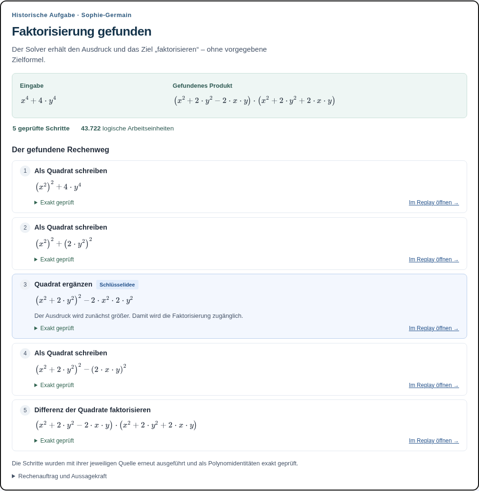
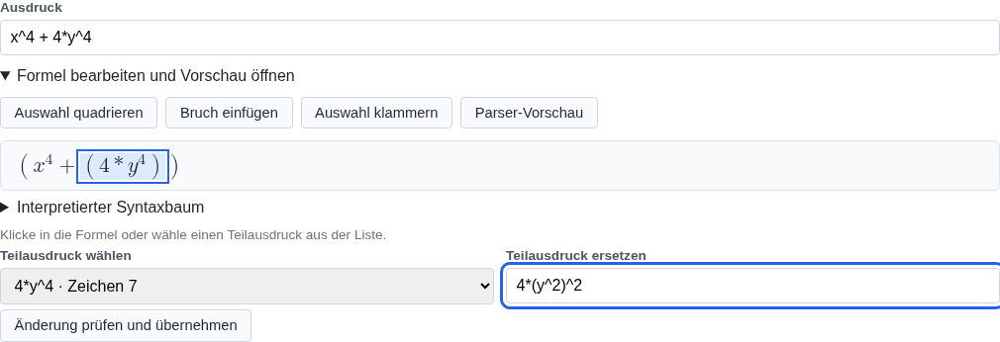
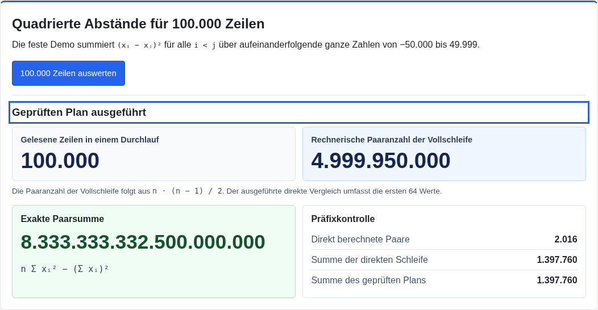
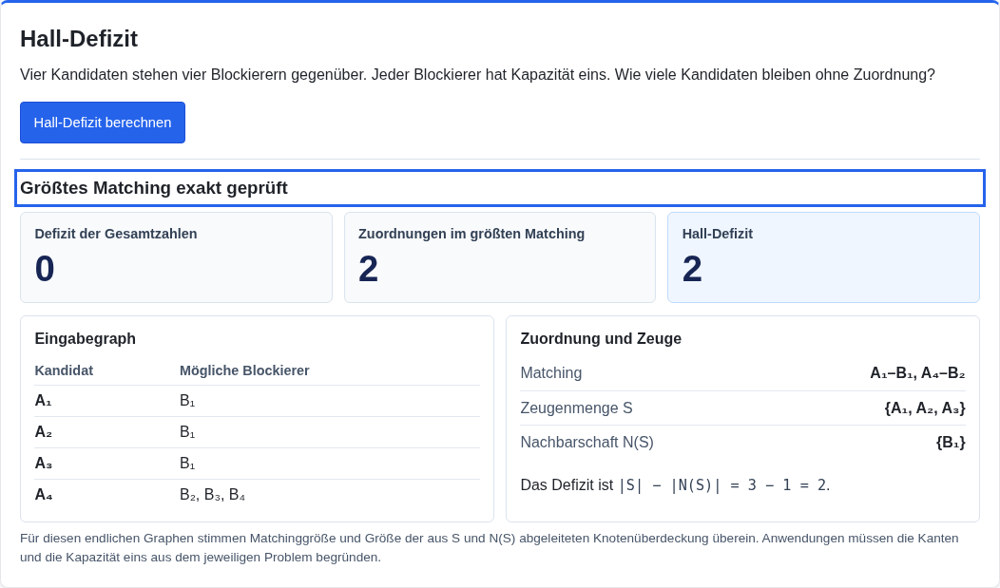
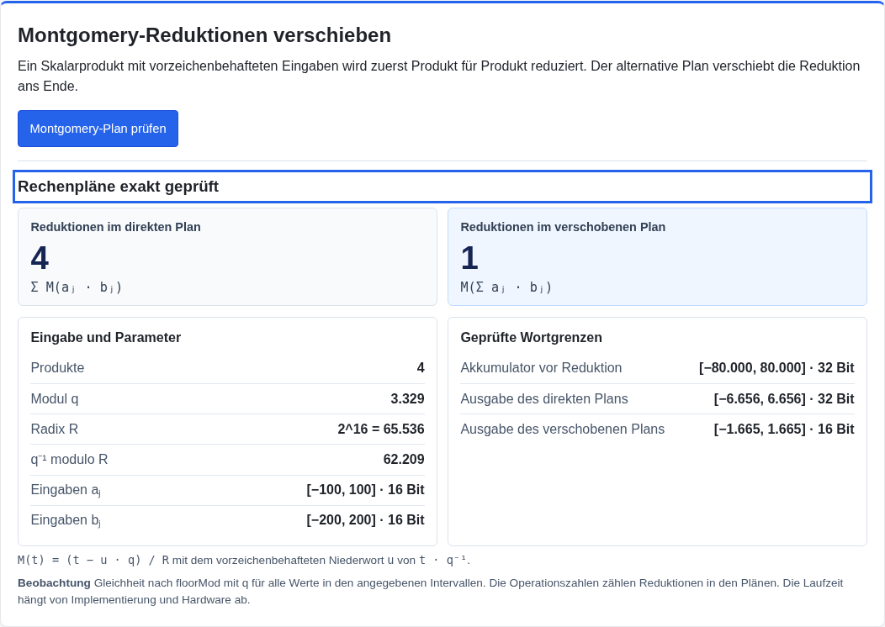
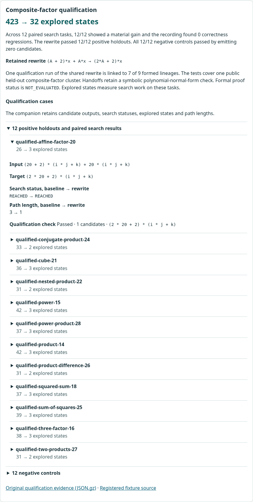

# Regelsuche in der Workbench

Die Beispiele zeigen, was Regelsuche aus einer Eingabe herleitet, welche
Prüfungen sie ausführt und wie sich der Aufwand vergleichen lässt. Die
Bildschirmaufnahmen stammen aus der laufenden Anwendung. [Workbench starten](../README.md#schnellstart)

## Neue ausführbare Beispiele im Quell-SDK

Diese Java-25-Beispiele verwenden den aktuellen `0.5.4-SNAPSHOT`-Quellstand.
Sie besitzen noch keine eigene Workbench-Karte und sind nicht im veröffentlichten SDK 0.5.3 enthalten.

| Beispiel | Geprüftes Ergebnis | Vertrag und Grenzen |
| --- | --- | --- |
| [Lokale Constraints zählen](../examples/external-consumers/FiniteConstraintCount.java) | Die Ausschlüsse `a && b`, `b && c` ergeben exakt 5; unter `b=true` 1 und unter `b=false` 4 | [Unabhängige Eliminationsspur und Zeuge](research/finite-constraint-counting.md) |
| [Zyklische Energiekredite](../examples/external-consumers/EnergyCredits.java) | Das Zweizustandsspiel erhält Kredite `(2,0)` und Max wählt Kante 0 | [Alle Min-Kanten und geschlossener Bereich](research/energy-game-certificates.md) |
| [SOS-Potential](../examples/external-consumers/SosPotential.java) | Sucht `V=x²` für `x -> x-1` auf aktiven Zuständen `x>=1`, Mindestabnahme 1 | [SOS, Voraussetzungen und Übergangsvertrag](research/sos-synthesis.md) |
| [Bilineare Faltung](../examples/external-consumers/BilinearSearch.java) | Drei gemeinsame Produkte; `(2,3)*(4,5)` ergibt `[8,22,15]` | [Vollständiger Koeffizientenvergleich und Operationskosten](research/bilinear-program-search.md) |
| [Rationale Matrixformel](../examples/external-consumers/RationalMatrixFormula.java) | $(X^{-1})^{-1}+I$ ist an der singulären Beispielmatrix undefiniert und ergibt an der invertierbaren Matrix die Einträge `[2,1,0,3]` in Zeilenfolge | [Affine Realisierung und Definitionsbedingungen](research/rational-formula-realization.md) |
| [Dynamische Quotientenalgebra](../examples/external-consumers/DynamicQuotient.java) | $1/(T-1)$ über $\mathbb F_5$ modulo $T^2-1$ ist auf $T-1$ undefiniert und auf $T+1$ gleich 2 | [Teilerfremde Abdeckung und Zweigprüfung](research/dynamic-algebra-evaluation.md) |

Mit den aus diesem Checkout gebauten SDK- und Kern-JARs samt Laufzeitabhängigkeiten
in `lib/`: `java --class-path 'lib/*' examples/external-consumers/SosPotential.java`.
Für die anderen Beispiele den jeweiligen verlinkten Dateinamen einsetzen.

## Sophie-Germain in der Workbench faktorisieren

Wähle unter den Demo-Karten **Sophie-Germain faktorisieren**. Die Demo nutzt
die bekannte historische Aufgabe `x^4 + 4*y^4`. Der mathematische Kern erhält
als Ziel eine nichttriviale Faktorisierung. Die Produktform ist dabei offen.

Der abgezogene Kreuzterm ist selbst ein Quadrat. Mit $u=x^2$ und $v=2y^2$
wird aus $u^2+v^2$ die Form $(u+v)^2-2uv$. Hier ist $2uv=4x^2y^2=(2xy)^2$.
Die Differenz zweier Quadrate lässt sich anschließend faktorisieren.

$$
x^4+4y^4 = (x^2+2y^2)^2-(2xy)^2 = (x^2+2y^2-2xy)(x^2+2y^2+2xy)
$$

Die Zusammenfassung zeigt das Ergebnis und alle fünf geprüften Schritte. Am Schritt
**Quadrat ergänzen** öffnet **Im Replay öffnen** die exakte Vorher- und
Nachherform dieses Schritts. **Exakt geprüft** klappt die zugehörigen
Prüfdaten auf. **Graph** macht den aufgezeichneten Pfad sichtbar.

Der Lauf verwendet die im Programm implementierten allgemeinen
Konstruktionsverfahren. Er prüft jeden Schritt und das Ergebnis exakt als
Polynomidentitäten. Das Replay zeigt die ausgeführten Konstruktionsoperationen
und fasst deren interne Rechenschritte zusammen. Der angezeigte Prüfstatus
steht für diese Polynomprüfung. Beim gezeigten Lauf fallen **43.722 logische
Arbeitseinheiten** für Suche und Prüfung an. Unter **Rechenauftrag und
Aussagekraft** stehen die Grenzen des Laufs, darunter 32 primitive Schritte,
Suchtiefe 8, 512 Zustände und je 10.000.000 Einheiten für Theorie- und
Gesamtarbeit. Formale Lean-Beweise haben einen eigenen Prüfablauf. [Proof-Jobs](proof-workbench.md)

[Ansicht bei 390 Pixel Breite](assets/screenshots/historical-sophie-germain-mobile.png) ·
[Aufnahmedaten für Desktop](assets/screenshots/historical-sophie-germain.json) und
[schmale Ansicht](assets/screenshots/historical-sophie-germain-mobile.json) ·
[Rechenweg, Budget und Prüfmethode](research/structural-construction-learning.md#the-frozen-catalog-through-one-source-only-task-solver)

### Eingabe in der Formelvorschau bearbeiten

Gib `x^4 + 4*y^4` im Feld **Ausdruck** ein. Öffne **Formel bearbeiten und
Vorschau öffnen** und wähle **Parser-Vorschau**. Klicke auf den zweiten
Summanden `4*y^4` oder wähle ihn aus der Liste. Gib `4*(y^2)^2` als
Ersatz ein. **Änderung prüfen und übernehmen** aktualisiert den Ausdruck,
sobald der Parser die bearbeitete Formel akzeptiert.

[Ansicht bei 390 Pixel Breite](assets/screenshots/visual-formula-edit-mobile.png) ·
[Aufnahmedaten für Desktop](assets/screenshots/visual-formula-edit.json) und
[schmale Ansicht](assets/screenshots/visual-formula-edit-mobile.json) ·
[Bedienung im Workbench-Handbuch](web-workbench.md#einen-teilausdruck-in-der-formel-bearbeiten)

## Ein Durchlauf für eine Paarsumme

1. Öffne **Berechnung optimieren** und springe über **Zum Lauf mit 100.000
   Zeilen** zur festen Demo. Wähle **100.000 Zeilen auswerten**. Die Workbench
   erzeugt die aufeinanderfolgenden Werte von −50.000 bis 49.999 und
   summiert die quadrierten Abstände aller ungeordneten Paare.
2. Der hergeleitete Plan liest jede Zeile einmal. Er berechnet die Summe
   $n\sum_i x_i^2-(\sum_i x_i)^2$ und liefert exakt
   **8.333.333.332.500.000.000**. Die symbolische Prüfung bindet den Plan an
   den Summanden `(x_i-x_j)^2`.
3. Die Workbench vergleicht den Plan für die ersten **64 Werte** mit der
   direkten Schleife über **2.016 Paare**. Beide ergeben **1.397.760**.
   Die **4.999.950.000 Paare** für den ganzen Datensatz sind die rechnerische
   Paaranzahl $n(n-1)/2$. Der direkte Lauf und seine Kontrolle beziehen sich
   auf das Präfix.

[Ansicht bei 390 Pixel Breite](assets/screenshots/pair-reduction-large-mobile.png) ·
[Aufnahmedaten für Desktop](assets/screenshots/pair-reduction-large.json) und
[schmale Ansicht](assets/screenshots/pair-reduction-large-mobile.json) ·
[Varianten und Eingabehilfe](user-workflows.md#summenschleifen-optimieren) ·
[SDK und Nachweis](../regelsuche-optimization-sdk/FINITE_SERIES.md#one-pass-pair-reductions)

Im frei editierbaren Formular liefert **Algorithmus herleiten** für die
Beispielwerte `2`, `-1` und `5` den exakten Wert **54**. Unter **Herleitung
und Prüfung** siehst du die Zwischensummen und den symbolischen Vergleich
der Einzel- und Paarbeiträge. [Geprüfter Plan im Formular](assets/screenshots/pair-reduction-result.png) ·
[Formularansicht bei 390 Pixel Breite](assets/screenshots/pair-reduction-mobile.png)

## Ein lokales Hall-Defizit nachweisen

Öffne unter den Demo-Karten **Exakte Rechennachweise** und wähle **Hall-Defizit
berechnen**. Vier Kandidaten stehen vier Blockierern mit Kapazität eins
gegenüber. $A_1$, $A_2$ und $A_3$ haben ausschließlich $B_1$ als Nachbarn.
$A_4$ hat $B_2$, $B_3$ und $B_4$ als Nachbarn.

Der Vergleich der Gesamtzahlen ergibt **0**. Das größte Matching enthält
**2 Zuordnungen**, etwa $A_1$–$B_1$ und $A_4$–$B_2$. Die Workbench zeigt die
Zeugenmenge $S=\{A_1,A_2,A_3\}$ und ihre vollständige Nachbarschaft
$N(S)=\{B_1\}$. Daraus folgt das **Hall-Defizit 2**. Der Prüfer gewinnt aus
$S$ und $N(S)$ die Knotenüberdeckung $\{A_4,B_1\}$. Deren Größe stimmt mit
der Größe des Matchings überein und beweist seine Optimalität in diesem
endlichen Graphen. Für Anwendungen müssen Kanten und Kapazität aus dem
jeweiligen Problem begründet werden.

[Ansicht bei 390 Pixel Breite](assets/screenshots/hall-deficit-mobile.png) ·
[Aufnahmedaten für Desktop](assets/screenshots/hall-deficit.json) und
[schmale Ansicht](assets/screenshots/hall-deficit-mobile.json) ·
[Kernprüfung und Vergleich](research/bipartite-matching.md)

## Montgomery-Reduktionen im Skalarprodukt verschieben

Wähle unter **Exakte Rechennachweise** die Aktion **Montgomery-Plan prüfen**.
Die Workbench plant ein Skalarprodukt aus vier Produkten mit $q=3329$,
$R=2^{16}$ und $q^{-1}\bmod R=62209$. Die vorzeichenbehafteten Eingaben
liegen in $[-100,100]$ und $[-200,200]$. Der direkte Plan reduziert jedes
Produkt. Der geprüfte Zielplan summiert die Produkte in einem
32-Bit-Akkumulator und reduziert einmal am Ende. Der Akkumulator bleibt
im Intervall $[-80000,80000]$.

Der Prüfer berechnet die Wortgrenzen erneut und prüft, dass beide Pläne
für die angegebenen Eingabebereiche denselben kanonischen Rest modulo $q$
liefern. **4 → 1** zählt die Reduktionen der beiden endlichen Rechenpläne.
Eine konkrete Laufzeit hängt auch von Implementierung und Hardware ab.

[Ansicht bei 390 Pixel Breite](assets/screenshots/montgomery-planning-mobile.png) ·
[Aufnahmedaten für Desktop](assets/screenshots/montgomery-planning.json) und
[schmale Ansicht](assets/screenshots/montgomery-planning-mobile.json) ·
[Kernprüfung und Vergleich](research/montgomery-schedules.md)

## Eine gelernte Regel im Vergleich

Wähle über **Regeln lernen und vergleichen** die Aktion **Aufgezeichneten
Lernvergleich öffnen (Englisch)**.
Unter **Composite-factor qualification** findest du den Fall
`qualified-affine-factor-20` in den **12 positive holdouts and paired search results**.

| | Gespeicherter Fall |
| --- | --- |
| Eingabe | `(20 + 2) * (i * j + k) + 20 * (i * j + k)` |
| Gesuchte Zieldarstellung | `(2 * 20 + 2) * (i * j + k)` |
| Gelernte Regel | `(A + 2)*x + A*x → (2*A + 2)*x` |
| Verbesserte Basis | Ziel erreicht, 26 untersuchte Zustände, 3 Umformungen |
| Mit gelernter Regel | Ziel erreicht, 3 untersuchte Zustände, 1 Umformung |

Die Qualifikation prüfte die Regel symbolisch mit Polynomnormalformen. Der
formale Proof-Status lautet `NOT_EVALUATED`. Die Oberfläche öffnet das
aufgezeichnete Ergebnis und die gespeicherten Kontrollen. Die Zustandszahlen
messen Sucharbeit in diesem Fall. Lern-, Lade- und Prüfkosten sowie die
Laufzeit brauchen eine eigene Bilanz.

[Ansicht bei 390 Pixel Breite](assets/screenshots/learned-rule-comparison-mobile.png) ·
[Aufnahmedaten für Desktop](assets/screenshots/learned-rule-comparison.json) und
[schmale Ansicht](assets/screenshots/learned-rule-comparison-mobile.json) ·
[Aufgabe und Suchaufwand als SVG](generated/autonomous-discovery-walkthrough-shared-core-v3/representative-search.svg) ·
[Vollständiger Walkthrough und Reproduktion](autonomous-discovery-walkthrough.md)

## Forschungsbefunde zur logischen Arbeit

| Entwicklungssatz | Direkter Vergleich | Mit wiederverwendetem Wissen |
| --- | ---: | ---: |
| 32 Strukturaufgaben | 506.872 Einheiten | 163.881 Einheiten (**67,7 % weniger**) |
| 80 Rekurrenzanfragen | 70.336 Einheiten | 39.774 Einheiten (**43,5 % weniger**) |

- **Strukturaufgaben.** Beide Verfahren lösen 24 von 32 Aufgaben. Der Satz
  wiederholt vier Strukturvorlagen. Die Bilanz umfasst Erwerb, Validierung
  und erneute Vorbereitung. [Vergleich und Reproduktion](research/structural-construction-learning.md#executed-development-results)
- **Rekurrenzanfragen.** Beide Verfahren liefern für 48 von 80 Anfragen ein
  geprüftes Gesetz. Die Bilanz enthält Erwerb, Laden, erneute Prüfung und
  Fehlversuche. Bei fünf Anfragen liegen die Gesamtkosten über der direkten
  Suche. [Vergleich und Reproduktion](research/recurrence-proof-selection.md#verrechnete-arbeit)

Beide Versuche zählen logische Arbeit im jeweiligen Kostenmodell. Die Werte
beschreiben diese Entwicklungssätze. [Forschungsstand](discovery-status.md#neuere-rechenpläne-und-lernbefunde)

## Detailnachweise zur Algebra-Suche

Die archivierten Suchläufe zur quadratischen Ergänzung und zur
Sophie-Germain-Faktorisierung zeigen Zwischenformen, Brückenregeln und die
spätere Anwendung des jeweiligen Makros. Die Archivläufe verwenden einen
eigenen Szenariovertrag. Eingaben, Ziele, Graphgrößen und
kanonische Evidence-IDs stehen in der
[generierten Algebra-Galerie](generated/discovery/gallery.md).

| Szenario | Suchgraph | Kanonischer Nachweis |
| --- | --- | --- |
| Quadratische Ergänzung | [Suchgraph](generated/discovery/complete-square/search-space.svg) | [Evidence JSON](generated/discovery/complete-square/evidence.json) |
| Sophie-Germain-Faktorisierung | [Suchgraph](generated/discovery/sophie-germain/search-space.svg) | [Evidence JSON](generated/discovery/sophie-germain/evidence.json) |

Der aktuelle qualifizierte Walkthrough dokumentiert den Aufbau des
Kandidaten, seine Prüfung und die paarweise Auswertung auf zurückgehaltenen
Aufgaben. Seine Ergebnisübersicht führt die Anspruchsgrenze
`NO EXTERNAL NOVELTY CLAIM`.
[Ablauf](generated/autonomous-discovery-walkthrough-shared-core-v3/sequence.svg) ·
[Kandidatenherkunft](generated/autonomous-discovery-walkthrough-shared-core-v3/candidate-lineage.svg) ·
[Gepaarter Nutzenvergleich](generated/autonomous-discovery-walkthrough-shared-core-v3/paired-utility.svg) ·
[Schema der Ergebniskarte](schemas/regelsuche-autonomous-discovery-result-card-v1.schema.json)
