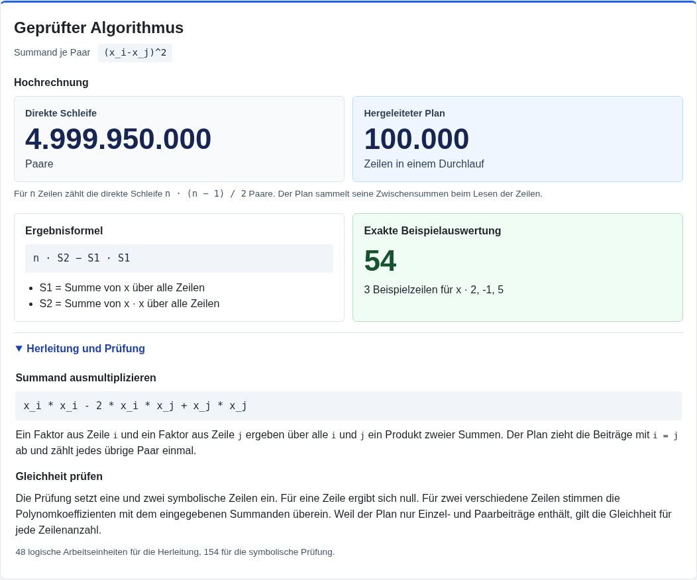
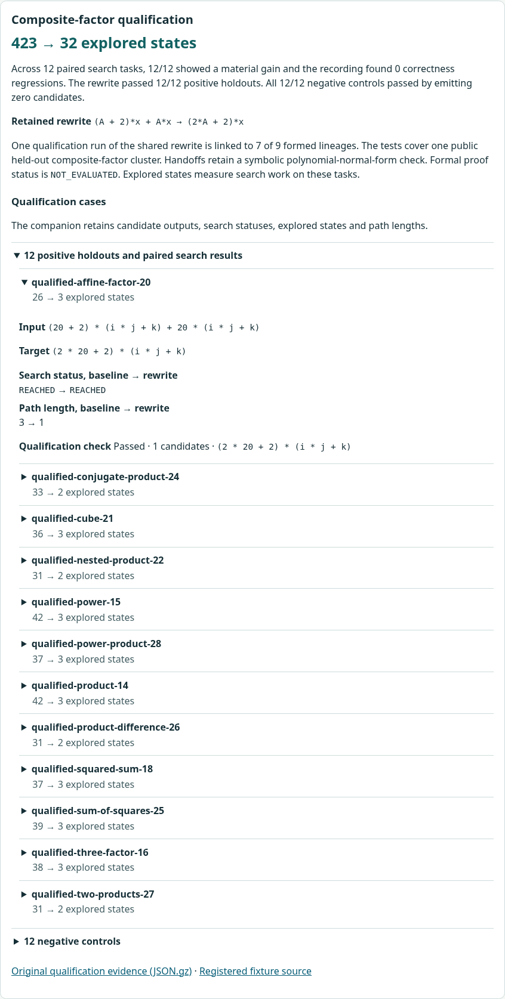
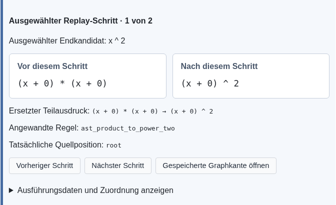

# Regelsuche in der Workbench

Die Beispiele zeigen, was Regelsuche aus einer Eingabe herleitet, welche
Prüfungen sie ausführt und wie sich der Aufwand vergleichen lässt. Die
Bildschirmaufnahmen stammen aus der laufenden Anwendung. [Workbench starten](../README.md#schnellstart)

## Ein Durchlauf für eine Paarsumme

1. Öffne **Berechnung optimieren** und wähle **Quadrierte Abstände**. Der
   Summand `(x_i-x_j)^2` beschreibt den quadrierten Abstand zweier Zeilen.
   Lass `100000` als **Zeilenanzahl für den Vergleich** und `2`, `-1`, `5`
   unter **Beispielwerte zur exakten Auswertung (optional)** stehen.
2. Wähle **Algorithmus herleiten**. Der Plan liest jede Zeile einmal und
   summiert Werte und Quadrate. Für $n$ Zeilen ergibt sich die Paarsumme
   $n\sum_i x_i^2-(\sum_i x_i)^2$. Die Workbench berechnet für die drei
   eingegebenen Zeilen exakt **54**.
3. Öffne **Herleitung und Prüfung**. Die symbolische Prüfung vergleicht
   Einzel- und Paarbeiträge mit dem ursprünglichen Polynom. Für 100.000 Zeilen
   stellt die **Hochrechnung** die **4.999.950.000 Paare** der direkten
   Schleife einem Durchlauf über 100.000 Zeilen gegenüber. Die Zahl folgt aus
   $n(n-1)/2$. Ausgeführt wird die exakte Auswertung der drei Beispielzeilen.

[Ansicht bei 390 Pixel Breite](assets/screenshots/pair-reduction-mobile.png) ·
[Aufnahmedaten für Desktop](assets/screenshots/pair-reduction-result.json) und
[schmale Ansicht](assets/screenshots/pair-reduction-mobile.json) ·
[Varianten und Eingabehilfe](user-workflows.md#summenschleifen-optimieren) ·
[SDK und Nachweis](../regelsuche-optimization-sdk/FINITE_SERIES.md#one-pass-pair-reductions)

## Eine gelernte Regel im Vergleich

Wähle über **Regeln lernen und vergleichen** die Aktion **Aufgezeichneten
Lernvergleich öffnen (Englisch)**.
Unter **Composite-factor qualification** findest du den Fall
`qualified-affine-factor-20` in den **12 positive holdouts and paired search results**.

| | Gespeicherter Fall |
| --- | --- |
| Eingabe | `(20 + 2) * (i * j + k) + 20 * (i * j + k)` |
| Gesuchte Zieldarstellung | `(2 * 20 + 2) * (i * j + k)` |
| Gelernte Regel | `(A + 2)*x + A*x → (2*A + 2)*x` |
| Verbesserte Basis | Ziel erreicht, 26 untersuchte Zustände, 3 Umformungen |
| Mit gelernter Regel | Ziel erreicht, 3 untersuchte Zustände, 1 Umformung |

Die Qualifikation prüfte die Regel symbolisch mit Polynomnormalformen. Der
formale Proof-Status lautet `NOT_EVALUATED`. Die Oberfläche öffnet das
aufgezeichnete Ergebnis und die gespeicherten Kontrollen. Die Zustandszahlen
messen Sucharbeit in diesem Fall. Lern-, Lade- und Prüfkosten sowie die
Laufzeit brauchen eine eigene Bilanz.

[Ansicht bei 390 Pixel Breite](assets/screenshots/learned-rule-comparison-mobile.png) ·
[Aufnahmedaten für Desktop](assets/screenshots/learned-rule-comparison.json) und
[schmale Ansicht](assets/screenshots/learned-rule-comparison-mobile.json) ·
[Aufgabe und Suchaufwand als SVG](generated/autonomous-discovery-walkthrough-shared-core-v3/representative-search.svg) ·
[Vollständiger Walkthrough und Reproduktion](autonomous-discovery-walkthrough.md)

## Einen ausgeführten Kandidatenschritt im Replay prüfen

Der native Suchlauf startet bei `(x + 0) * (x + 0)`. Die Aufnahme zeigt den
ersten Schritt zu `(x + 0)^2` am Wurzelknoten; ausgewählter Endkandidat ist
`x^2`. Öffnest du im
Kandidatendossier einen Schritt aus der **Replay-Ansicht der gespeicherten Schritte**,
siehst du den vollständigen Ausdruck **Vor diesem Schritt** und **Nach diesem
Schritt**. Darunter stehen der ersetzte Teilausdruck, die angewandte Regel und die
tatsächliche Quellposition. **Ausführungsdaten und Zuordnung anzeigen** öffnet
die gespeicherten Details. **Gespeicherte Graphkante öffnen** führt zur
zugehörigen Kante. Der ausgewählte Endkandidat bleibt beim Wechsel erhalten.

Der Browsertest führt die native Suche aus und zeichnet ihre gespeicherten
Schritte in der Workbench auf.

[Ansicht bei 390 Pixel Breite](assets/screenshots/candidate-replay-mobile.png) ·
[Aufnahmedaten für Desktop](assets/screenshots/candidate-replay.json) und
[schmale Ansicht](assets/screenshots/candidate-replay-mobile.json) ·
[Aufnahme und Reproduktion](testing.md#dokumentationsaufnahmen)

## Forschungsbefunde zur logischen Arbeit

| Entwicklungssatz | Direkter Vergleich | Mit wiederverwendetem Wissen |
| --- | ---: | ---: |
| 32 Strukturaufgaben | 506.872 Einheiten | 163.881 Einheiten (**67,7 % weniger**) |
| 80 Rekurrenzanfragen | 70.336 Einheiten | 39.774 Einheiten (**43,5 % weniger**) |

- **Strukturaufgaben.** Beide Verfahren lösen 24 von 32 Aufgaben. Der Satz
  wiederholt vier Strukturvorlagen. Die Bilanz umfasst Erwerb, Validierung
  und erneute Vorbereitung. [Vergleich und Reproduktion](research/structural-construction-learning.md#executed-development-results)
- **Rekurrenzanfragen.** Beide Verfahren liefern für 48 von 80 Anfragen ein
  geprüftes Gesetz. Die Bilanz enthält Erwerb, Laden, erneute Prüfung und
  Fehlversuche. Bei fünf Anfragen liegen die Gesamtkosten über der direkten
  Suche. [Vergleich und Reproduktion](research/recurrence-proof-selection.md#verrechnete-arbeit)

Beide Versuche zählen logische Arbeit im jeweiligen Kostenmodell. Die Werte
beschreiben diese Entwicklungssätze. [Forschungsstand](discovery-status.md#neuere-rechenpläne-und-lernbefunde)

## Detailnachweise zur Algebra-Suche

Die historischen Suchläufe zur quadratischen Ergänzung und zur
Sophie-Germain-Faktorisierung zeigen Zwischenformen, Brückenregeln und die
spätere Anwendung des jeweiligen Makros. Eingaben, Ziele, Graphgrößen und
kanonische Evidence-IDs stehen in der
[generierten Algebra-Galerie](generated/discovery/gallery.md).

| Szenario | Suchgraph | Kanonischer Nachweis |
| --- | --- | --- |
| Quadratische Ergänzung | [Suchgraph](generated/discovery/complete-square/search-space.svg) | [Evidence JSON](generated/discovery/complete-square/evidence.json) |
| Sophie-Germain-Faktorisierung | [Suchgraph](generated/discovery/sophie-germain/search-space.svg) | [Evidence JSON](generated/discovery/sophie-germain/evidence.json) |

Der aktuelle qualifizierte Walkthrough dokumentiert den Aufbau des
Kandidaten, seine Prüfung und die paarweise Auswertung auf zurückgehaltenen
Aufgaben. Seine Ergebnisübersicht führt die Anspruchsgrenze
`NO EXTERNAL NOVELTY CLAIM`.
[Ablauf](generated/autonomous-discovery-walkthrough-shared-core-v3/sequence.svg) ·
[Kandidatenherkunft](generated/autonomous-discovery-walkthrough-shared-core-v3/candidate-lineage.svg) ·
[Gepaarter Nutzenvergleich](generated/autonomous-discovery-walkthrough-shared-core-v3/paired-utility.svg) ·
[Schema der Ergebniskarte](schemas/regelsuche-autonomous-discovery-result-card-v1.schema.json)
