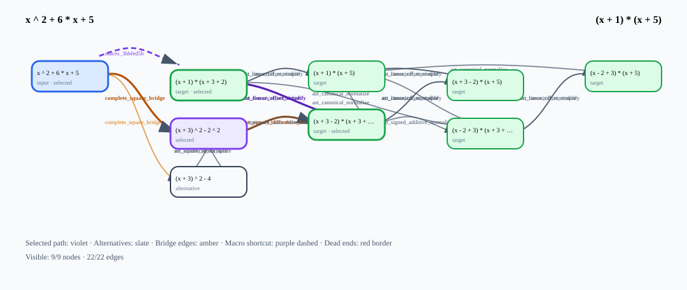
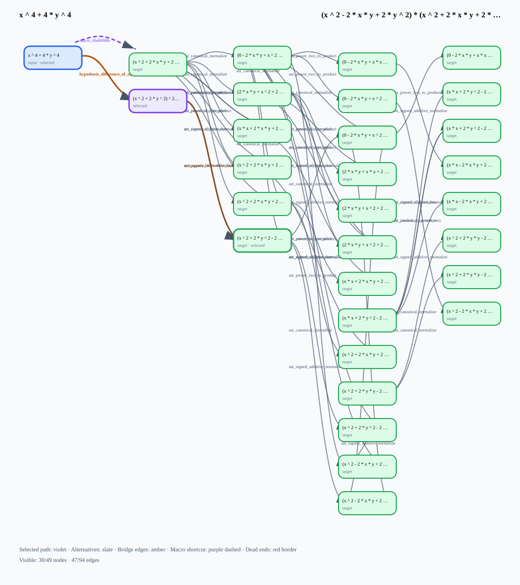

# Generated Algebra Discovery Gallery

Generated by `:app:generateDiscoveryGallery`. See the [Workbench gallery](../../demo-gallery.md) for the browser examples.

Public entries are admitted only after `PublicBenchmarkEvidenceGate` accepts their generated search evidence. See the [rejection report](public-scenario-rejections.md).

## Complete-square factorization

- Input: `x ^ 2 + 6 * x + 5`
- Target: `(x + 1) * (x + 5)`
- Evidence status: success
- Oracle status: `UNAVAILABLE`
- Bridge used: `complete_square_bridge`, `ast_square_difference_factor`
- Macro learned: `macro_3bbfed5b`
- Macro reused: `macro_3bbfed5b`
- Search-space excerpt: [SVG](complete-square/search-space.svg)
- Evidence JSON link: [evidence.json](complete-square/evidence.json)
- Canonical evidence ID: [`regelsuche.discovery-evidence/v1#sha256:76d9396b1caec0d1510ff9d0c1f08dbe3441f8f526f11882456e1f7eb77fed17`](complete-square/evidence.json)

## Sophie-Germain discovery

- Input: `x ^ 4 + 4 * y ^ 4`
- Target: `(x ^ 2 - 2 * x * y + 2 * y ^ 2) * (x ^ 2 + 2 * x * y + 2 * y ^ 2)`
- Evidence status: success
- Oracle status: `UNAVAILABLE`
- Hidden bridge used: `hypothesis_difference_of_squares_preparation`, `ast_square_difference_factor`
- Macro learned: `macro_6bd0496b`
- Macro reused: `macro_6bd0496b`
- Search-space excerpt: [SVG](sophie-germain/search-space.svg)
- Evidence JSON link: [evidence.json](sophie-germain/evidence.json)
- Canonical evidence ID: [`regelsuche.discovery-evidence/v1#sha256:2d55b4073625adf9dee6d6567be4ed18bc5d953c9da0d30cb79559f762ffd9a6`](sophie-germain/evidence.json)

## Scenario comparison

| Scenario | Success | Oracle | States | Edges | Bridge rules | Learned macros | Reused macros |
|---|---|---|---:|---:|---:|---:|---:|
| Complete-square factorization | yes | unavailable | 9 | 22 | 2 | 1 | 1 |
| Sophie-Germain hidden structure | yes | unavailable | 49 | 94 | 2 | 1 | 1 |

