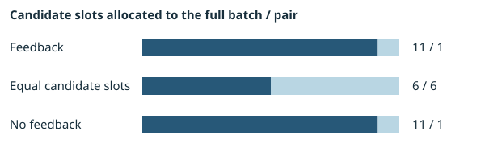

# Controller comparison on the public one-round campaign

Each row replays the same observations with a different controller. Positive and negative columns count executed holdouts. One candidate can be shared across policies. Slot counts are allocations.

| Policy | Full-batch outputs | Pair outputs | Rejected clusters | Positive | Negative | Next decisions | Stop reason |
| --- | --- | --- | --- | --- | --- | --- | --- |
| Feedback | 1 | 0 | 1 | 3 | 3 | 0 | CAMPAIGN_COMPLETE |
| Equal candidate slots | 1 | 0 | 1 | 3 | 3 | 0 | FIXED_ONE_ROUND_HORIZON |
| No feedback | 1 | 0 | 1 | 3 | 3 | 0 | FIXED_ONE_ROUND_HORIZON |

## Resource accounts by policy

| Policy | Stage | Unit | Configured | Executed | Skipped | Remaining |
| --- | --- | --- | --- | --- | --- | --- |
| Feedback | GENERATION | GENERATED_STATES | 100000 | 240 | 0 | 99760 |
| Feedback | GENERATION | EXPLORED_STATES | 10000 | 228 | 0 | 9772 |
| Feedback | GENERATION | OBSERVATIONS | 12 | 12 | 0 | 0 |
| Feedback | CANDIDATE_FORMATION | MINING_BATCHES | 2 | 2 | 0 | 0 |
| Feedback | CANDIDATE_FORMATION | CANDIDATES | 12 | 1 | 11 | 0 |
| Feedback | VALIDATION | VALIDATION_CHECKS | 120 | 6 | 0 | 114 |
| Feedback | COUNTEREXAMPLE_SEARCH | COUNTEREXAMPLE_ATTEMPTS | 1200 | 77 | 0 | 1123 |
| Feedback | PROJECT_NOVELTY | NOVELTY_COMPARISONS | 1200 | 7 | 0 | 1193 |
| Feedback | PROOF | PROOF_ATTEMPTS | 12 | 1 | 0 | 11 |
| Feedback | LIFECYCLE_HANDOFF | LIFECYCLE_HANDOFFS | 12 | 1 | 0 | 11 |
| Equal candidate slots | GENERATION | GENERATED_STATES | 100000 | 240 | 0 | 99760 |
| Equal candidate slots | GENERATION | EXPLORED_STATES | 10000 | 228 | 0 | 9772 |
| Equal candidate slots | GENERATION | OBSERVATIONS | 12 | 12 | 0 | 0 |
| Equal candidate slots | CANDIDATE_FORMATION | MINING_BATCHES | 2 | 2 | 0 | 0 |
| Equal candidate slots | CANDIDATE_FORMATION | CANDIDATES | 12 | 1 | 11 | 0 |
| Equal candidate slots | VALIDATION | VALIDATION_CHECKS | 120 | 6 | 0 | 114 |
| Equal candidate slots | COUNTEREXAMPLE_SEARCH | COUNTEREXAMPLE_ATTEMPTS | 1200 | 77 | 0 | 1123 |
| Equal candidate slots | PROJECT_NOVELTY | NOVELTY_COMPARISONS | 1200 | 7 | 0 | 1193 |
| Equal candidate slots | PROOF | PROOF_ATTEMPTS | 12 | 1 | 0 | 11 |
| Equal candidate slots | LIFECYCLE_HANDOFF | LIFECYCLE_HANDOFFS | 12 | 1 | 0 | 11 |
| No feedback | GENERATION | GENERATED_STATES | 100000 | 240 | 0 | 99760 |
| No feedback | GENERATION | EXPLORED_STATES | 10000 | 228 | 0 | 9772 |
| No feedback | GENERATION | OBSERVATIONS | 12 | 12 | 0 | 0 |
| No feedback | CANDIDATE_FORMATION | MINING_BATCHES | 2 | 2 | 0 | 0 |
| No feedback | CANDIDATE_FORMATION | CANDIDATES | 12 | 1 | 11 | 0 |
| No feedback | VALIDATION | VALIDATION_CHECKS | 120 | 6 | 0 | 114 |
| No feedback | COUNTEREXAMPLE_SEARCH | COUNTEREXAMPLE_ATTEMPTS | 1200 | 77 | 0 | 1123 |
| No feedback | PROJECT_NOVELTY | NOVELTY_COMPARISONS | 1200 | 7 | 0 | 1193 |
| No feedback | PROOF | PROOF_ATTEMPTS | 12 | 1 | 0 | 11 |
| No feedback | LIFECYCLE_HANDOFF | LIFECYCLE_HANDOFFS | 12 | 1 | 0 | 11 |

## Limits recorded by the experiment

- `NO_CHOICE_BETWEEN_ELIGIBLE_CONTINUATIONS`
- `NO_COMMON_CURRENCY_FOR_UNIFORM_CROSS_STAGE_ALLOCATION`
- `SINGLE_PUBLIC_CAMPAIGN`

Uncompressed bytes: 138180. SHA-256: `04eaa8a4bb800791b62fed4d1cab4fcd6c3e2e4de46a9c561a24a03272972d19`. Preregistered protocol SHA-256: `7ddc243adfd1297f1c1c331453872cbea501fe2beddcfd7145a7c1e8be250f8e`. [Raw matrix at the integrated revision](https://github.com/carstenartur/Regelsuche/blob/99383b298bfbc0b857c33b20233ae166107bc7cc/docs/evidence/autopilot-controller-comparison-v1.json.gz).
