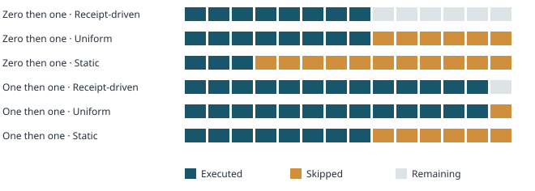

# Open-target formation and reuse

Each cell gives successes over registered slots across four campaigns. Sequence successes require a frozen model to match the observed prefix and continuation. Rational successes require guarded target reachability. Macro successes require paired utility improvement. Empty counts campaign-arm slots without an emitted candidate. Campaign seeds repeat the same public tasks.

| Form | Arm | Emitted | Empty | TRAIN | VALID. | TEST |
| --- | --- | --- | --- | --- | --- | --- |
| Recurrence | Production | 4 | 0 | 4/8 | 0/8 | 0/8 |
| Recurrence | Enumeration | 4 | 0 | 4/8 | 0/8 | 0/8 |
| Recurrence | Seeded random | 5 | 1 | 3/8 | 0/8 | 0/8 |
| Newton | Production | 4 | 0 | 4/8 | 0/8 | 0/8 |
| Newton | Enumeration | 0 | 4 | 0/8 | 0/8 | 0/8 |
| Newton | Seeded random | 2 | 2 | 2/8 | 0/8 | 0/8 |
| Rational | Production | 4 | 0 | 16/16 | 0/16 | 8/16 |
| Rational | Enumeration | 4 | 0 | 16/16 | 0/16 | 8/16 |
| Rational | Seeded random | 4 | 0 | 16/16 | 0/16 | 8/16 |
| Macro | Production | 8 | 0 | 4/16 | 0/16 | 0/16 |
| Macro | Enumeration | 8 | 0 | 4/16 | 0/16 | 0/16 |
| Macro | Seeded random | 7 | 0 | 4/16 | 0/16 | 0/16 |

## Historical project inventories

| Form | Emissions | Distinct keys | Catalogue matches by emission |
| --- | --- | --- | --- |
| Recurrence | 13 | 3 | 9 same model, 4 no match |
| Newton | 6 | 1 | 6 same model |
| Rational | 12 | 2 | 8 same program, 4 program subset |
| Macro | 23 | 2 | 12 no match, 11 pattern only |

Each recurrence had one supporting TRAIN case. The Newton model came from one square-sequence case. Rational programs received four witnesses from two TRAIN clusters, with exact field identities under the supplied nonzero premises. Each macro pattern drew support from one cluster and had a symbolic polynomial-normal-form witness. Both native macro patterns received NEW from the seven-rule checker; one matched an earlier macro pattern with different operations. Inventory matches cover the registered project revision. [All 48 slots and frozen input identities](https://github.com/carstenartur/Regelsuche/blob/e5a3c7919128335691bcb1b3f0de04e58ef63e10/research/benchmarks/candidate-independent/track-c-project-inventory/audit-result.json.gz).

## Paired public cross-family transfer

Eight untargeted formation searches yielded a bridge for coefficient pairs separated by two. Each family below supplied one positive target and one negative control. Target entries show baseline / bridge-enabled successes. Matcher calls and applications cover both targets.

| Family | Role | Positive | Negative | Calls | Applications |
| --- | --- | --- | --- | --- | --- |
| coefficient-gap-two | Formation | 1 / 1 | 0 / 0 | 9 | 0 |
| coefficient-twin-prime | Formation | 1 / 1 | 0 / 0 | 9 | 0 |
| trigonometric | Held-out | 1 / 1 | 0 / 0 | 8 | 0 |
| univariate-polynomial | Held-out | 1 / 1 | 0 / 0 | 27 | 0 |

Native factorization reached all four positive targets. No negative control was reached. The formed bridge emitted no move, its proof gate was ineligible and no held-out work reduction was measured. [All 16 native search runs](https://github.com/carstenartur/Regelsuche/blob/0d8c6545478cbb8eca50e539124c8118939055aa/research/benchmarks/track-d-public-transfer/transfer-result.json).

## Seven-stage allocation

Both panels ran the same registered twelve seeds and two six-slot formation batches. Completed counts eligible lineages that reached conservative lifecycle handoff. The two batches in the second panel formed different lineages for the same conjecture.

| Batch outputs | Policy | Completed / formed | Executed | Skipped | Remaining | Qualified / formed |
| --- | --- | --- | --- | --- | --- | --- |
| Zero then one | Receipt-driven | 1/1 | 8 | 0 | 6 | 1/1 |
| Zero then one | Uniform | 1/1 | 8 | 6 | 0 | 1/1 |
| Zero then one | Static | 0/1 | 3 | 11 | 0 | 0/1 |
| One then one | Receipt-driven | 2/2 | 13 | 0 | 1 | 2/2 |
| One then one | Uniform | 2/2 | 13 | 1 | 0 | 2/2 |
| One then one | Static | 1/2 | 8 | 6 | 0 | 1/2 |

Every lane had fourteen stage dispatch opportunities. The evaluator uses one validation and one counterexample ticket in the same call. Receipt-driven and uniform allocation completed the same branches using identical native work. The static policy reserved both candidate chains for the first batch. Tickets do not establish CPU parity. [All six dispatch traces and native resource ledgers](https://github.com/carstenartur/Regelsuche/blob/ab12f340e7e6f894ff32088adbc2df1dfa4f11b8/research/benchmarks/track-f-stage-allocation/measured.json.gz).

The completed handoffs all retained a confirmed symbolic polynomial-normal-form check. Their formal-proof status remains `NOT_EVALUATED`. The public composite-factor suite evaluated the same rewrite in one post-handoff run linked to 7 of 9 formed lineages. It passed 12/12 positive holdouts and 12/12 negative controls. The paired search measured material gains on 12 of 12 tasks and 0 correctness regressions, with 423 explored states in the baseline and 32 with the rewrite. The other 2 handoffs stayed incomplete and had no qualification evaluation. [Public qualification companion](../../research/benchmarks/track-f-stage-allocation/qualification.json.gz). Decoded evidence SHA-256 `ad45f3b6f84013a0872d7761079e2fae768cbe5178a73cff20667ea7e75c863d`.

## Cross-observation formation

| Policy | Batches | Candidates | Rejected clusters |
| --- | --- | --- | --- |
| Production | 2 | 1 | 1 |
| No fan-in | 2 | 0 | 14 |

On the original public production campaign, the same miner formed a candidate only when it could pool observations. The control preserves all twelve seeds, capacity and native rejection records. [All batch receipts](https://github.com/carstenartur/Regelsuche/blob/5c34abe7b98d4ea508cceec282c9f304de6144c9/docs/evidence/open-target-fan-in-v1.json.gz).

## Historical matched discovery-component ablations

The original component run used the pre-#1245 validator on historical input/output observations and a fixed challenge. Each control disables one production mechanism under the same slot and validation ceilings. Score changes compare the candidates present in both arms. Changed prefixes count budgets whose selected IDs differ from production.

| Policy | Candidates | Score changes | Changed prefixes | Refuted | Revisions |
| --- | --- | --- | --- | --- | --- |
| Production | 5 | 0 | 0 | 0 | 0 |
| No fan-in | 0 | 0 | 46 | 0 | 0 |
| No refinement | 5 | 0 | 0 | 0 | 0 |
| No novelty scheduling | 5 | 4 | 0 | 0 | 0 |

The production miner pooled 23 observations and formed five candidates. Four known candidates gained two score points each when project novelty was disabled. Every budget from zero to 46 selected the same ordered prefix as production. The five terminal checks found no counterexample and issued no revised statement. The historical log-product control, counted separately in every arm, also produced no counterexample. It inferred three positivity guards. This panel provides no evidence about how often refinement repairs a refuted conjecture. [Matched inputs, schedules, challenges and control](https://github.com/carstenartur/Regelsuche/blob/a0abfcbf8b136047c52e51d87a13b0933433f9d7/docs/evidence/discovery-component-panel-v1.json.gz).

## Validator-version comparison

The same public component protocol ran with the exactness revision. No witness means the sampled search returned NO_COUNTEREXAMPLE_FOUND. Inconclusive means the validator could not decide within its exact arithmetic bounds. The separate log control is excluded from the mined-check denominator.

| Policy | Mined checks | Earlier: no witness | Earlier inconclusive | Exact: no witness | Exact inconclusive |
| --- | --- | --- | --- | --- | --- |
| Production | 5 | 5 | 0 | 4 | 1 |
| No fan-in | 0 | 0 | 0 | 0 | 0 |
| No refinement | 5 | 5 | 0 | 4 | 1 |
| No novelty scheduling | 5 | 5 | 0 | 4 | 1 |

One distinct rational cancellation candidate changed to inconclusive in every arm that formed it. Its exact search found no defined scalar pair within the bounds. The four other mined candidates retained their bounded no-witness status. Twelve polynomial source pairs now carry exact univariate normal-form provenance. Both versions of the separate log control retained three positivity guards and found no refuting witness. [Historical component execution](https://github.com/carstenartur/Regelsuche/blob/a0abfcbf8b136047c52e51d87a13b0933433f9d7/docs/evidence/discovery-component-panel-v1.json.gz) · [Exact execution](https://github.com/carstenartur/Regelsuche/blob/5ddc10da51282fd6e23a01c3b6c7de1dd3bfa3cb/docs/evidence/discovery-component-panel-exact-v1.json.gz).

The separate hidden-rule replay used the same twenty tasks under all three validator revisions. The corrected exact polynomial normalizer handles quotients whose denominator simplifies exactly to a nonzero constant. A missing admitted candidate can leave negative holdouts unexecuted. The false-positive count covers the executed holdouts only.

| Validator | Search | Recovered | Negative executed | Negative skipped | False positives |
| --- | --- | --- | --- | --- | --- |
| Historical | Best-first | 19/20 | 38/40 | 2 | 0 |
| Historical | Project A* | 19/20 | 38/40 | 2 | 0 |
| Exact (initial) | Best-first | 13/20 | 26/40 | 14 | 0 |
| Exact (initial) | Project A* | 13/20 | 26/40 | 14 | 0 |
| Exact (corrected) | Best-first | 19/20 | 38/40 | 2 | 0 |
| Exact (corrected) | Project A* | 19/20 | 38/40 | 2 | 0 |

[Historical hidden-rule execution](https://github.com/carstenartur/Regelsuche/blob/df5d2a28d9ad0184b3d80d1723ba23aca9b92a7b/research/benchmarks/comparative-v2/hidden-rule-historical.json.gz) · [Initial exact execution](https://github.com/carstenartur/Regelsuche/blob/df5d2a28d9ad0184b3d80d1723ba23aca9b92a7b/research/benchmarks/comparative-v2/hidden-rule-current.json.gz) · [Corrected exact execution](https://github.com/carstenartur/Regelsuche/blob/afc8018d45138b2cabff2462e9bb4cd48700cf13/research/benchmarks/comparative-v2/hidden-rule-constant-denominators.json.gz).

## Target-directed search (A1)

| Search | Reached | States explored | Successors | Path steps | Engine calls |
| --- | --- | --- | --- | --- | --- |
| a-star | 3/3 | 6 | 11 | 3 | 3 |
| beam | 3/3 | 19 | 26 | 3 | 19 |
| best-first | 3/3 | 6 | 11 | 3 | 3 |

All arms saw the target and shared the same budget. Work totals span the three fixed cases.

## Target-free simplification (A2)

| Configuration | Reference forms | Cases where the reference form was missed |
| --- | --- | --- |
| randomized-valid-rewrite-control | 5/7 | factor-cancellation, cubic-cancellation |
| regelsuche-untargeted-best-first | 6/7 | cubic-cancellation |
| sympy-cas-apart | 7/7 | None |
| sympy-cas-cancel | 6/7 | square-folding |
| sympy-cas-factor | 7/7 | None |
| sympy-cas-simplifier | 7/7 | None |
| sympy-cas-together | 5/7 | factor-cancellation, cubic-cancellation |
| sympy-cas-trigsimp | 4/7 | constant-fraction, factor-cancellation, cubic-cancellation |

Formation had no pinned reference. Each output was checked against the same reference-form surface. A missed form can be another expression, so this comparison measures reference-form recovery. The small corpus covers one domain and has no independent assumption-aware output validation.

## Equality validation (E1)

| Validator | Confirmed | Refuted | Lossless translation | Proof or certificate status |
| --- | --- | --- | --- | --- |
| polynomial-normal-form | 1 | 1 | 2/2 | validation certificate retained: 2 |
| sympy-cas-equality | 1 | 1 | 2/2 | validation certificate retained: 2 |
| z3-smt-proof | 1 | 1 | 2/2 | formal certificate retained: 1, not requested: 1 |

Each validator received the same positive identity and false equality. Confirmation and refutation are both correct outcomes for their respective cases. Retained validation certificates and formal certificates carry different scope.

[A1, A2 and E1 case records and resource ledgers](https://github.com/carstenartur/Regelsuche/blob/c5a4824f9060da04be1684bd0cef8e37001f109e/research/benchmarks/comparative-v2/legacy.json.gz). Decoded evidence SHA-256 `8ea2d80744f5e70eb2af7c6e6115de8d194276516329d6ca683ca1d8262ebdcf`.

## Shared-fragment rewriting (E2)

| Search | Reference cost | Cost missed | Unsupported | Proof or replay status |
| --- | --- | --- | --- | --- |
| best-first | 5/6 | 1 | 3 | not requested: 3, primitive replayed: 6 |
| equality-saturation | 5/6 | 1 | 3 | detached certificate checked: 6, not requested: 3 |

Both arms used the same 8 unconditional rules. The reference cost counts operators. Search uses path work and equality saturation uses graph work, each with its own budget. The evidence retains primitive replay, detached certificate checks and native work per case.

| Unsupported case | Translation boundaries across the two arms |
| --- | --- |
| guarded-division | division outside fragment: 2 |
| symbolic-power | power outside fragment: 2 |
| unregistered-function | function outside fragment: 2 |

[E2 case records, native budgets and proof objects](https://github.com/carstenartur/Regelsuche/blob/c5a4824f9060da04be1684bd0cef8e37001f109e/research/benchmarks/comparative-v2/rewriting.json.gz). Decoded evidence SHA-256 `860bf1a08de7f605ad688569781d4d13c5868f8eef3ed3656932b3efa4b33651`.

## Open-target case outcomes

The pooled counts below summarize the same public case slots shown by arm above. Campaign seeds repeat the case inputs. Empty candidates, failed prefix matches and downstream misses remain distinct.

| Form | Split | Evaluations | Terminal outcomes across all arms |
| --- | --- | --- | --- |
| Recurrence | TRAIN | 24 | confirmed: 11, no output: 2, prefix mismatch: 11 |
| Recurrence | VALIDATION | 24 | no output: 2, prefix mismatch: 22 |
| Recurrence | TEST | 24 | no output: 2, prefix mismatch: 22 |
| Newton | TRAIN | 24 | confirmed: 6, no output: 12, prefix mismatch: 6 |
| Newton | VALIDATION | 24 | no output: 12, prefix mismatch: 12 |
| Newton | TEST | 24 | no output: 12, prefix mismatch: 12 |
| Rational | TRAIN | 48 | reached and confirmed: 48 |
| Rational | VALIDATION | 48 | no result: 48 |
| Rational | TEST | 48 | no result: 24, reached and confirmed: 24 |
| Macro | TRAIN | 48 | improved: 12, no improvement: 36 |
| Macro | VALIDATION | 48 | no improvement: 48 |
| Macro | TEST | 48 | no result: 48 |

## Reproduction on the previous integrated revision

These byte comparisons refer to [the recorded revision](https://github.com/carstenartur/Regelsuche/commit/c5a4824f9060da04be1684bd0cef8e37001f109e). The manuscript archive's own revision and file inventory identify the current package.

| Artifact | Executed environments | Byte-identical outputs |
| --- | --- | --- |
| Public benchmark | Two checkout publications and the pinned benchmark container | Canonical report and 39 evidence attachments |
| Manuscript package | Two clean archive builds and a source-package-only offline replay | 43,133,031-byte archive including a 16-page PDF |

Benchmark report SHA-256 `b09f14feef9d0d5dbab340b037fbc76f274afb007462cfd987418770238cc45c`. [Benchmark verification](https://github.com/carstenartur/Regelsuche/issues/235).

Manuscript archive SHA-256 `97aaee2651d6dbcd8e7c54db6fc98fd0a1c70a9b8e6c76c692a5cc1632a949ca`. PDF SHA-256 `e609c22b0d3ad458cdc0b8d4f43e42d9115682447e94762062149fd36ee94769`. [Manuscript verification](https://github.com/carstenartur/Regelsuche/issues/388).
